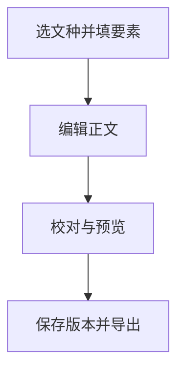

# 公文助手使用手册

<!-- [目录] -->

## 开始起草 {#chap:quickstart}

从主菜单新建文档，选择文种，在左侧填写主送、发文单位、联系人等要素。有密级的稿件按文种填写密级和保密期限。按需从标准词库选取单位和人员。在正文区输入 Markdown，也可以导入已有材料或从 Word 粘贴。切到版式预览检查分页、附件、落款和版记。

图：起草与导出流程

## 校对和导出 {#chap:proofread}

在工具栏点击「重新校验」，查看要素、格式、引用和用词提示。展开审校结果可逐条采纳或忽略建议。校对词表可在主菜单的「词库」中维护。确认正文和版式后，按需导出 Word 或 PDF，也可以在 PDF 查看器中打印。

## 稿件与版本 {#chap:manuscripts}

点击「保存」把稿件收入稿件库。提交版本可以固定当前正文和表单，之后可在版本对照中查看差异或回退。向另一台机器传递稿件时，在稿件管理中导出或导入 `.gwx` 稿件包。呈批件可在保存后挂接随行稿件。

## 研究报告 {#chap:research}

新建研究报告后，可在正文中插入目录、图表、公式与参考文献引用。在文档要素中维护封面和参考文献数据，使用预览检查章节编号、交叉引用与文献著录，再导出成品。

## 本机数据 {#chap:data}

在设置中选择输出目录、字体、套版和输入法。应用锁保护本机工作区。定期从设置页导出备份，恢复前先核对备份来源和内容。
