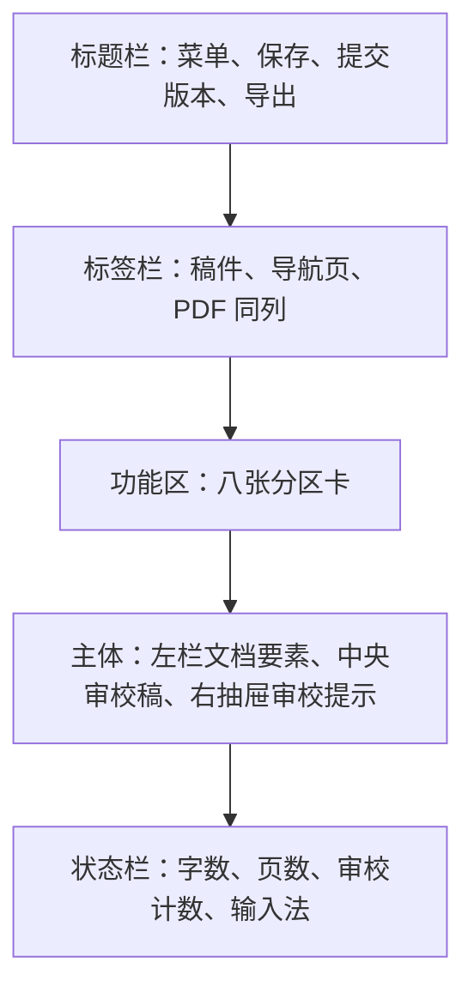
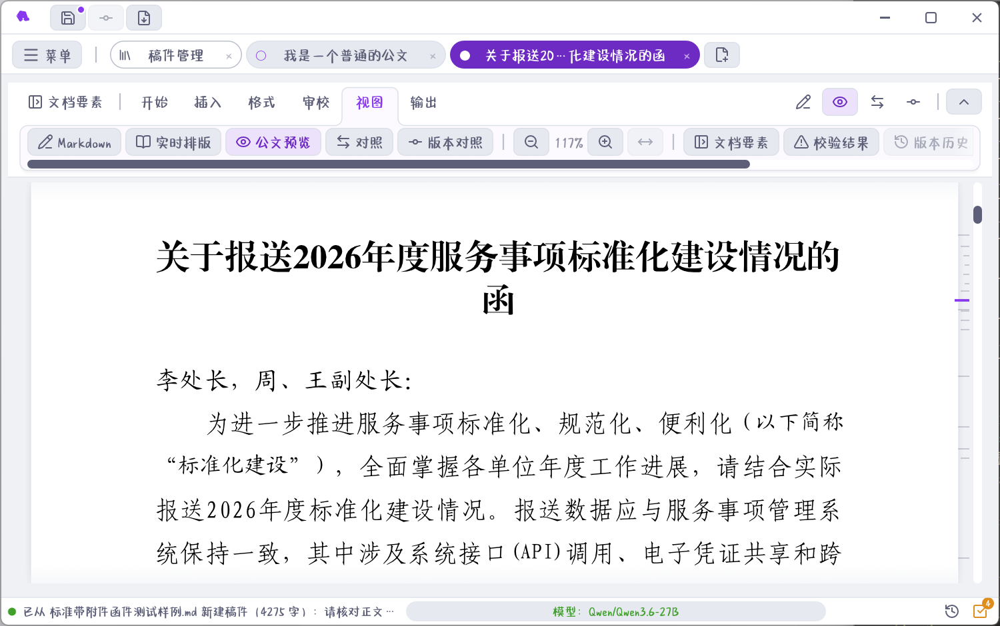
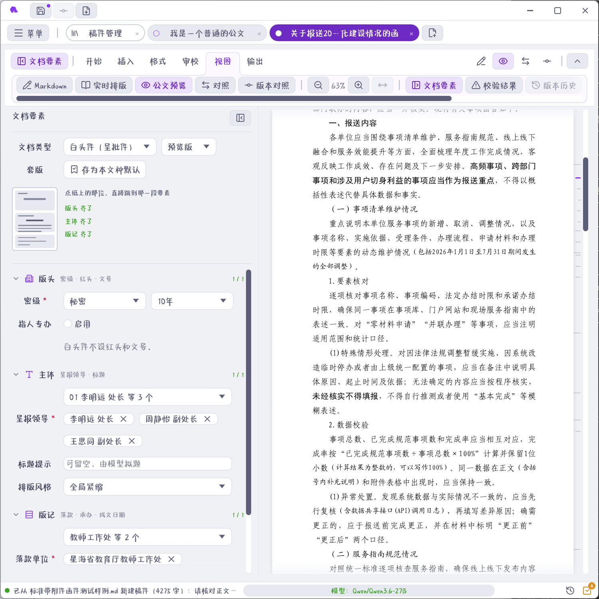

## 界面总览 {#chap:ui}

### 窗口五区

图：主窗口五区

启动后的主窗口从上到下是这样的：

| 区域 | 在哪 | 干什么 |
|---|---|---|
| 标题栏 | 最顶 | 菜单按钮、窗口标题、保存 / 提交版本 / 导出快捷入口、窗口控制 |
| 标签栏 | 标题栏下 | 已打开的稿件、导航页、PDF 混排在同一条标签栏上 |
| 功能区 | 标签栏下 | 开始 / 插入 / 研报 / 格式 / 审校 / 视图 / 输出 七个分区 |
| 左栏 + 中央 | 主体左侧与中间 | 左边文档要素填报区，中央审校稿编辑与预览 |
| 右抽屉 | 主体右侧 | 审校提示，可收起；版本历史已并入版本对照模式左侧的时间轴 |
| 状态栏 | 最底 | 状态文案、中文 / 英文计数、实际页数、审校提示计数、候选区入口（有条目时显示）、版本历史入口（进版本对照并展开时间轴）、输入法状态 |

功能区第二行可以整体收起，收起后只剩分区卡标题，正文能多出一条工具栏的高度。

打开稿件时，状态栏右侧常驻显示 `中文 2,386 字 · 英文 128 词 · 页数未算`。
中文按汉字计，英文按单词计，连字符或撇号相连算一词；统计标题、正文、表格、图题和
附件正文，排除空白、标点与 Markdown 标记。数字另列在悬停详情里，图片内文字不识别。
研究报告不把链接地址、引用键、锚点或公式命令当作英文词，公式只计文字说明。

页数按需计算，不自动排版：点一下状态栏这行才开始，按当前稿件完整定稿的 Typst 实际
排版数出，含封面、目录和空白页，不含花脸稿和送批随行件。长稿排版慢、占用内存多
（三百多页的稿子一次要几百 MB），所以停笔不会自动触发。`页数…` 表示正在排版，
`页数 —` 表示排版失败，悬停可看原因、点击可重试；算出的页数留到正文、要素、字体或
编号变化为止，改动后重新变成 `页数未算`。不需要页数时导出 PDF 也能看到总页数。

### 起草页长什么样

打开一篇稿件后，中央是**审校稿**——你的 Markdown 正文就在这里写。左边是要素表单，右边是审校提示抽屉。版本历史不在右边：它在版本对照模式左侧的时间轴里（见第{@chap:versions}章「版本、对照与花脸稿」）。

要素表单**默认收起**。这是有意的：打开稿件第一眼应该是满屏的稿子，而不是一堆输入框。要填要素时点功能区左端的开关展开。

展开后，表单按纸面部位分三段：

- **版头**：密级、红头、文号；
- **主体**：主送、标题、正文体例；
- **版记**：抄送、承办、落款、成文日期。

表单顶部有一张**版面缩略导航图**：一张小纸画成三色块，点哪块跳哪段，缺项在图上标出来。填的时候随时知道自己在纸的哪个位置。

### 标签模型

标签栏上有三类标签，混排在一起：

- **稿件**：打开的一篇公文。标签上带状态标记（未保存是空心圈），双击可改名。
- **导航页**：稿件管理、任务助手、标准词库、校对词表、公文词表、输入法词表、AI 管理、知识库、设置、使用帮助。同一页不会重复开，已经开着就切过去。
- **PDF**：应用内打开的 PDF 查看器，比如导出的成品或盖章扫描件。

这么设计是为了**看设置不必丢掉稿件上下文**：切到设置改个字体，再点回稿件标签，稿子还在原来的位置。

十个导航页一览：

| 页面 | 管什么 |
|---|---|
| 稿件管理 | 稿件库：草稿、发布、归档、版本、盖章附件、稿件包（.gwx）导入导出 |
| 任务助手 | 交办事项的台账：三栏看板、关系与完成依赖、粘贴填表与待整理建议 |
| 标准词库 | 单位树、人员与联系方式，一次维护多处一致 |
| 校对词表 | 错别字、近义混淆、语病等六组校对规则 |
| 公文词表 | 从稿件收词，导出输入法码表 |
| 输入法词表 | 基础表、导入表与个人词条，查码、启停与修改记录 |
| AI 管理 | 模型服务、文字复核、知识库检索、技能、数据接口、工具调试台、润色预设与输出标准 |
| 知识库 | 导入历史成稿、建索引、检索与问答 |
| 设置 | 字体、主题、编号、密级、输入法、网络代理、数据备份等十一个分区 |
| 使用帮助 | 你正在读的这份手册（`F1` 随时打开） |

### 四种视图

中央区有四种显示模式，在功能区右端或「视图」分区切换：

| 视图 | 看到什么 | 适合 |
|---|---|---|
| 源码 | 带语法高亮的 Markdown | 写稿、改结构 |
| 版式预览 | 按公文字体行距渲染的纸面效果 | 对版、看成品 |
| 分栏 | 左源码、右版式 | 对照着改 |
| 版本对照 | 左栏 diff（可改字、可逐块还原）、右栏花脸稿预览 | 看自己改了什么 |

分栏对照改稿时，源码输入光标会同步显示在右侧纸面上：深蓝色加粗光标缓慢闪烁，输入或移动后立即亮起；当前纸面行铺一层淡蓝灯带，左侧留白显示定位箭头。灯带与箭头常驻，方便投影推稿时先找行、再找字。选中文字时改为显示选区；这些定位标记只用于屏幕预览，不进入导出或打印。

细节见第{@chap:editor}章「拟稿：源码编辑与四种视图」。Markdown 源码模式左侧有标题目录、右侧有可点击和拖动的全文缩略图。所有主题共用目录布局：目录标题与收起入口、当前章节左侧标记、低对比侧栏，无标题时自动收成窄图标栏；侧栏颜色跟随各主题的深浅配色；预览区右缘另有**刻度条导航**，鼠标靠近会推出大纲板。

### 主题与纸面

六套主题即点即换，菜单底部「外观主题」或设置页都能切。明色三套（Claude 奶油、MDEX 纸墨、锤子稿纸）、深色三套（北欧、复古暗、MDEX 夜墨），切换立即生效并保存。在 Omarchy 桌面上另多一张「跟随 Omarchy」：程序读 Omarchy 当前主题的 `colors.toml` 当场换算配色，并在后台每秒比对主题目录（`colors.toml` 与主题名），桌面换了主题不必再点，界面自己跟上。默认**跟随系统明暗**：浅色系统用 Claude 奶油，深色系统用复古暗，桌面切换深浅模式时界面跟着换；手动点选任一配色即改为手动选择。

「锤子稿纸」按锤子便签原图校准，以暖烟草棕渐变顶栏、浅蜂蜜桦木底板、奶油纸面与暖棕墨色文字，配合带横线和页边线的 Markdown 稿纸呈现拟物质感。标签栏采用浏览器式连接：未选中标签融入灰棕底栏，相邻未选中标签之间仅用短竖线分隔；选中标签以无描线的平滑凹角接入整幅浅色纸面，没有底部横线，加号常态只保留图标，边缘随设备缩放羽化；当前功能分区与按钮托盘连成一体；菜单、检索与外观使用融入灰棕栏底的米白文字和图标；输出命令保持单行，用短分隔线区分用途，不添加下方小字。稿件管理、标准词库、校对词表、公文词表和知识库共用柔和档案纸面、浅凹表头与细线台账，列表选中时以浅灰棕底和左侧标记提示，避免大面积黄底与强烈隔行色。源码模式的目录与正文共用一张稿本，目录使用浅灰米色侧页，缩略图收窄淡化；无标题时目录自动收成窄图标栏，空白稿隐藏缩略图。源码和对照模式都可使用，横线随实际换行、字号和滚动对齐；公文预览保留正式版式，跟随主题时使用暖白便签纸面与深褐墨色、淡双线页框与四角方形收口，纸顶轻压暗并带柔和投影；装饰只用于屏幕预览，不进入导出，显式选择白纸黑字或深色纸面时不显示。

**纸面明暗**是另一回事：屏幕上的公文预览可以跟随主题、白纸黑字或深色纸面，但**导出一律白纸黑字红头**。深色纸面只影响你看屏幕的舒适度，不会把红头印成灰的。

### 界面字体

界面字体不随应用打包：Windows 默认微软雅黑，Linux 默认 Noto Sans SC，macOS 默认苹方，也可以在设置里另选本机字体。屏幕上的公文预览用的是另一套**公文字体**（见第{@chap:settings}章「设置全解」的字体分区），两套互不干扰。
