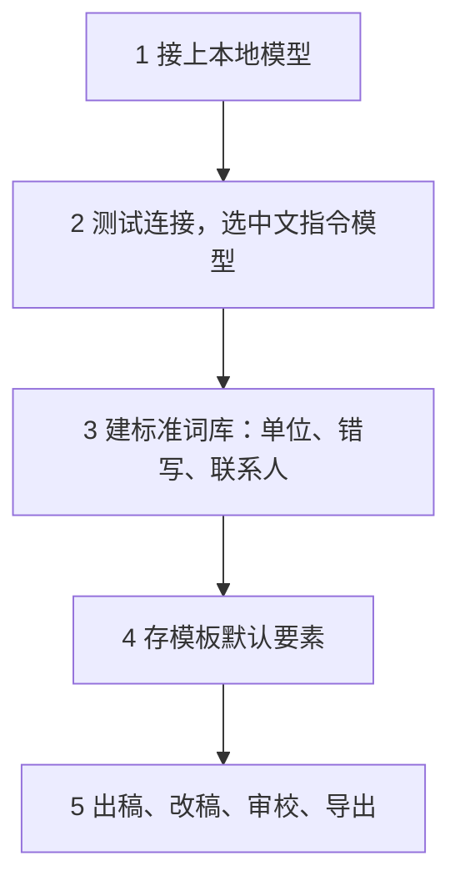

## 五分钟出第一份稿子 {#chap:quickstart}

### 五步流程

图：上手五步

第一次用这个程序，按下面五步走一遍就能出第一份稿子。设置页「网络与帮助 → 上手指引」里也有同样的五步。

首次启动会自动载入两篇示例稿（一篇公函、一篇白头件），可在「稿件管理」中打开参考，也可以直接修改或删除。

#### 1. 接上本地模型

到「AI 管理 → 模型服务」填接口地址（内网部署填 vLLM 等服务的地址）：

- **LM Studio**：先启动 Local Server，地址一般填 `http://127.0.0.1:1234/v1`。
- **Ollama**：先执行 `ollama serve`，地址填 `http://127.0.0.1:11434/v1`。

对话、Embedding、Rerank 三个配置互相独立（后两个在「AI 管理 → 知识库检索」），不用的可以留空。Ollama 的接法有专门说明，见第{@chap:knowledge}章「知识库与问答」。

#### 2. 测试连接并选模型

点「测试连接 / 刷新模型」，从下拉里选一个**中文指令模型**。起草用大模型，「AI 管理 → 文字复核」另配一个小模型也行（不配就都走起草模型）。

连不上的排查：服务有没有起来、端口对不对、防火墙拦没拦。详见附录{@chap:faq}「常见问题」。

#### 3. 建标准词库

到「标准词库」页维护三样东西：

- **单位全称**（含简称、别名、机关代字、层级编码）；
- **常见错写**（进了校对词表的错误写法）；
- **联系人电话**（人员挂在承办单位下）。

这一步是「一次维护，多处一致」的来源：要素表单的候选、AI 的事实闸门、校对词表、公文词表合并，都从这里取。词库可以等下再细调，先把最常用的几个单位和人录进去。

也可以用 Excel 批量来：「下载空白模板」→ 填好 → 「导入 Excel」。见第{@chap:vocabulary}章「标准词库」。

#### 4. 为每类模板存默认要素

在起草页左栏选好文种，把发文单位、联系人、呈报领导这些**每次都不变**的字段填一次，然后保存为该文种的默认配置。下次新建同文种的稿子，这些字段自动带出来。

九种文种的差别见第{@chap:profiles}章「立稿与要素填报」。不熟的话先用**公函**或**普通公文**。

#### 5. 出稿、改稿、审校、导出

1. **生成草稿**：用「AI 助手」侧栏或直接在中央区写 Markdown。侧栏按技能起草、仿写、整理材料、复函和润色，见第{@chap:ai-workbench}章「AI 侧栏与技能」。
2. **在右侧改稿**：正文永远在你自己手里，AI 给的是建议。
3. **处理审校提示**：右下状态栏点开审校抽屉。**必错**级清零，**疑似**级自己判断，**提示**级可整组关掉。见第{@chap:proofread}章「核稿：审校与校验」。
4. **导出签发稿**：功能区「输出」分区选格式，点导出。见第{@chap:export}章「导出、打印与文件命名」。

### 一个最小例子

假设要发一份商洽函，最快路径：

1. 菜单 → 新建空白文档（`Ctrl+N`），文种选**公函**；
2. 左栏版头填机关代字与序号（比如「办函〔2026〕12 号」），主体填主送单位，版记填承办与联系人；
3. 中央区写正文，`#` 起标题，正文写商洽事项；
4. 点右下角审校抽屉，把必错项一键替换掉；
5. 功能区「输出」点导出（默认出 PDF 与源码包，要 Word 另勾 DOCX）。

输出目录下会多一个以函号命名的文件夹，里面是 `.pdf`、`.docx`（勾了的话）与源码包。命名规则见第{@chap:export}章「导出、打印与文件命名」。

### 接下来读什么

| 你想 | 看 |
|---|---|
| 弄清一份公文从拟到归档怎么走 | 第{@chap:workflow}章「办文全流程」 |
| 把要素填对，让文种选对 | 第{@chap:profiles}章「立稿与要素填报」 |
| 熟悉编辑器与功能区 | 第{@chap:editor}章「拟稿」、第{@chap:ribbon}章「功能区」 |
| 用好 AI | 第{@chap:ai-guard}章「AI 的边界」、第{@chap:ai-workbench}章「AI 侧栏与技能」 |
| 备份与换机器 | 第{@chap:data}章「数据、备份与迁移」 |
