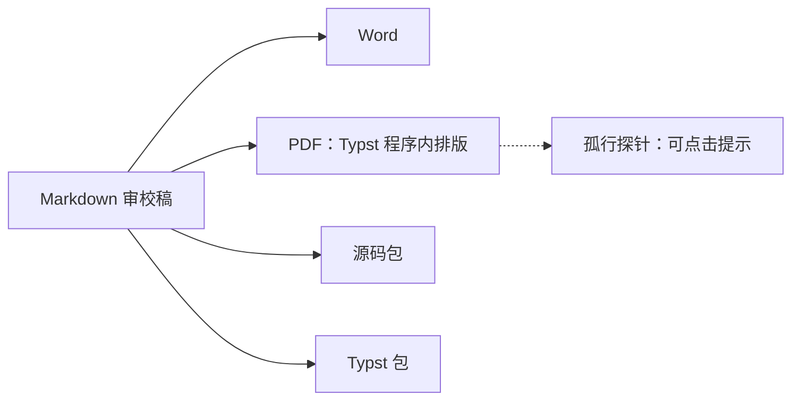

## 导出、打印与文件命名 {#chap:export}

### 导出在哪、怎么导

入口有两处：

- 功能区「输出」分区（最全，含格式勾选）；
- 标题栏快捷访问的「导出」按钮（用上次的勾选）。

导出链路一图流：


图：导出链路

程序做的事：

1. 生成 Markdown / DOCX（按勾选）；
2. 勾了 PDF 就排 PDF：内置 **Typst** 引擎在程序里直接排版，一份公文几十毫秒，完全离线，不依赖本机装任何排版软件；研究报告用它自己的版式模板，同样在程序里排；
3. 排完版回读**孤行探针**实测坐标，生成带正文位置的可点击提示；
4. 排版失败**不阻断导出**——PDF 缺失记「排版错误」，在审校抽屉用红色提示框显示，其余产物照常可用。

### 四个格式勾选与固定目录

启用应用锁后，凡是把用户内容写成普通文件的导出都会先显示「**导出文件可能泄露信息**」
确认框：PDF、Word、Markdown 和 Typst 源码包、打印前自动生成 PDF、直接打印、花脸稿、送批材料、
风格档案、标准词库/校对词表/输入法词表、公文四码词表与重码报告、自定义技能包、接口配置、
全量备份与稿件包等。
这些文件导出后不再受应用密码与本地加密保护，正文、图片、附件、人员与单位信息可能随
复制、同步或发送而泄露。确认保存位置与接收范围后，点「确认风险并继续」；取消或按 Esc
不生成文件。这个确认不能永久关闭。批量 PDF 的 7z 压缩包与稿件包使用独立密码保护，包内文件名也已加密，但解压后
的 PDF/正文仍是普通文件。不含用户数据的内置模板与使用帮助不提示；锁定应用不会加密或
撤回已经导出的成品。

| 勾选 | 产物 |
|---|---|
| Markdown | `-源码包.zip`：Markdown 源码与随文图片 |
| Word | `.docx` |
| PDF | `.pdf` |
| Typst 包 | `-Typst包.zip`：模板、数据与插图，装有常见中文字体的机器可用 Typst 命令行编译 |

Markdown 与 PDF 默认全勾，Typst 包默认不勾；Word 导出仍在完善，设置页里的 Word 勾选框
锁着不可选，要 Word 时点右侧的「WORD」成品图标单独出。

导出设置里另有「同时导出签收记录单与传发任务单（仅公函）」一个选项，默认不勾，见下文
《公函的两类随行单据》。

> [!提示]
>
> 只要 Word 不要 PDF？取消 PDF 勾选即可。反过来，公文的 PDF 由排版引擎按公文版式直接排出，不能从 Word 转——版式一致性就靠这条链路保证。

Typst 包是给「机器上装了 Typst」的场合准备的：包里不含字体，解压后在包目录执行
`typst compile gongwen.typ`（研究报告为 `research.typ`）即可出 PDF。所需字体清单与
与 App 内 PDF 的差异写在包内 `README.txt`；本机没有这些字体时，可用 `--font-path`
指向任意含字体的目录。

同一稿件反复导出始终使用同一目录，同名文件直接替换，不再生成带编号的副本。历史版本保存在稿件库中。

### 公函的两类随行单据

公函多一个「同时导出签收记录单与传发任务单（仅公函）」选项，默认**不勾**。勾上后
**每次导出两种都出**，都是**独立文件**，与原公函同目录：

| 单据 | 文件 | 份数 |
|---|---|---|
| 纸质《公文签收记录单》 | `<文类>-<机关代字>-<标题>-<纸面状态>_签收记录单.pdf`（单独出 Word 时是同名的 `_签收记录单.docx`） | 一份 |
| 电子《传发任务单》 | `传发任务单-<接收单位>.pdf` | **每家接收单位一份** |

- 两类单据都**不拼进公函正文**，可以单独打印、单独送达；
- 纸质签收单跟着本次选中的格式走：选了 Word 出 Word，选了 PDF 出 PDF；两种都没选时
  也出一份 PDF，免得勾了这一项却看不到纸单；
- 电子传发任务单**只出 PDF**，即使本次只导 Word 也照样出——它本来就是机要单据；
- 别的文种一律忽略这个选项，不生成这两类单据。

#### 纸质《公文签收记录单》

单据版式：A4 纵向、黑白、156mm 版心，题名「公文签收记录单」小标宋二号居中；上方是
文件名称、函号、发函单位、成文日期、密级等要素；中间是签收表，五列依次为**序号、
签收单位、签收方式、签收人、签收日期**，表头黑体四号、内容仿宋四号，外框稍粗、
内部细线；签收人（约 41mm）与签收日期（约 32mm）两栏最宽，签收行最低 18mm，便于
手写签名；跨页时重复表头、整行不拆；底部是送文人、联系电话、送文日期、备注两行手写栏，
行距放宽到 12mm，横线上方留足书写高度。

- **签收单位**按**主送在前、抄送在后**排列，同名单位按最终显示名去重，一单位一行；
- **签收方式**上下两行印「□电子」「□纸质」，由收件人手工勾选；
- **签收人、签收日期**留空，**送文人、联系电话、送文日期、备注**也留空，程序不替人填；
- 密级只在表格上方的要素行印一次，不在表格里逐行重复；草稿期还没有函号、成文日期时，
  对应要素留出手写横线；
- 主送、抄送都没填时，签收表留 5 行空行，签收单位手工填写。

#### 电子《传发任务单》

按用户给的 Word 模板复刻：A4 纵向、页边距 37/35/28/26mm，题名红色小标宋居中；主表
五列，依次是**分组标签（竖排）｜小节标签｜取值｜副标签｜副取值**：

- **收方**：接收单位、收件人、联系电话；
- **发方**：发文单位、签批人、联系人、联系电话、通知收件人情况；
- **涉密信息要素**：密级、时效要求、发后处理、信息类型（纸质文件 N 页）、公文标题；
- **备注**：照模板的事例排成编号条目（仿宋小四、固定行距），一行一条「1.」「2.」……。

表下是机要表两行（发方／收方机要机构、发送人／接收人、电话）与末行「保密单位
…… 分收到、…… 分发出」。填了保密负责单位时整体替换末行占位，不保留方括号；
单位名称过长时只横向压缩单位与日期，不换行、不改变字高。机要表与收发时间由机要密码机构手填。

取值分三类：

- **自动填**：接收单位、公文标题与函号、发文单位、联系人与电话、密级、正文页数；
- **按设置填**：题名（传输任务）、传字、签批人、时效要求、发后处理、备注、保密负责单位——
  在设置页「加密传输单」一节里配好，导出时照填（见第{@chap:settings}章）；
- **留白手写**：传字号码、机要表各项、收发时间。

**题名说的是「这次传的是什么任务」**，不是公文标题（公文标题印在表内的「标题」一栏）：

- 传输任务类型是**字典项**，在设置页「加密传输单」一节里增删，默认三项：
  **涉密信息加密传发任务单、公开信息明文传发任务单、公开信息密文传发任务单**；
- 同节第一行「传输任务」下拉里挑默认题名；不挑时按密级自动带（有密级为涉密信息加密、无密级为公开信息明文）。

**单子只有一页**：公文标题特别长时表内「标题」一栏会长高，整张单子容易挤到第二页。
程序有一条收紧阶梯，排版超出一页就按顺序收紧一档重排，直到排在一页为止。收紧顺序
是：题名前后的空白 → 题名字号与字距 → 表格字号（公文标题那一栏本来就是小一号）→
各行高度与备注行 → 上下页边距。题名与「标题」一栏的内容一个字不改。

- **收件人**在起草页表单末尾的「**传输单**」分段里按接收单位逐个选（主送、抄送的单位
  都列在这里，单位名前标了「主送 / 抄送」），电话随词条带出；
  没登记收件人的单位，单子上留出手写横线；词库里该单位只登记了一个人时自动带出他。

### 文件命名规则

每篇稿件使用一个固定目录：`文类-标题`；公函、红头呈批件在文类后增加机关代字，例如 `公函-某办函-关于商洽的函`、`红头呈批件-某办呈-关于调整安排的请示`。目录不带年份、流水号、提交版本名称或时间戳，编定号码后仍使用原目录。

- **签字版**只带机关代字（如「某办函」「某办呈」），不带年份和流水号；
- **盖章版**文件名带已填写的完整函号或呈号；未编号码时只带机关代字；
- 电话记录单、普通公文、研究报告不增加签字版／盖章版后缀；其他文类沿用表单选择的纸面状态；
- 同一版别、同一格式重复导出直接替换；修改文号后成功导出会清理本程序登记的该版别旧名成品，保留另一版别及用户自行放入的文件。旧规则生成的历史目录不自动整理；
- 目录最多 42 个字符；文件名连同扩展名、版别和用途后缀最多 42 个字符。超长标题保留首尾，中间用 `…` 代替，各格式共用同一标题缩略结果。文类、机关代字和文号等固定部分过长时提示调整；
- 电子《传发任务单》保持 `传发任务单-<接收单位>.pdf`，单位名过长同样从中间省略。

### 输出目录结构

```text
输出目录/
  公函-某办函-关于商洽的函/
    公函-某办函-关于商洽的函-签字版.pdf
    公函-某办函〔2026〕12号-关于商洽的函-盖章版.pdf
    公函-某办函〔2026〕12号-关于商洽的函-盖章版.docx
    传发任务单-某接收单位.pdf
```

目录中另有程序维护的隐藏导出清单，用于识别和清理旧名成品。

输出目录在「设置 → 输出与录入」里选，默认是**当前工作目录**。设置页可直接打开该目录。

源码包 `.zip` 里是 Markdown 正文与它引用的图片（研究报告另带 frontmatter 与 `references.bib`），拿到别的机器导入公文助手就能复现。

有公文引用时，主 `.md` 已展开成《名称》（文号），供普通 Markdown 工具使用；
包内另带 `-可编辑.md`，保存引用标记和快照。需要继续管理引用时导入可编辑文件，
或直接用稿件库的离线稿件包（`.gwx`）同步。Word / PDF 都使用本篇快照，不要求本机存在来源稿件。

### 成品三入口

「输出」分区的三个图标是 PDF / WORD / Typst 包成品入口，**点一下就是导出并打开**：

- 按当前审校稿只导这一种格式，不改设置里勾好的常用格式，同名成品直接替换；
- 导完 PDF 在应用内打开，WORD 用系统程序打开，Typst 包在文件管理器里定位；
- 右键可复制、定位已有成品；「导出到…」读取当前正文和表单重新生成所选格式，保存到指定位置并替换同名文件，不复制先前的旧成品。

导出成功后，状态栏显示实际输出子目录；勾了公函随行单据时，文件数后面还会交代
「（含签收记录单 1 份、传发任务单 3 份）」，一眼看得出单据出了没有。
「输出目录」直接在文件管理器里选中本篇最近导出的成品；还没导出过时打开设置中的输出根目录。

### 研究报告的导出

研究报告的产物更多，见第{@chap:research}章「研究报告专章」。要点：

- PDF 是一个文件：封面、目录、正文、附录与参考文献都在里面；
- 勾选 Word 时走研究报告自己的 mdx 转换器，封面、目录与分节页码与 PDF 对齐；
- 数学公式与预览用同一个排版器，预览看到的公式就是 PDF 上的公式。

### 批量导出 PDF

稿件管理页勾选多篇 → 「导出 PDF」：

- 后台逐篇排版，不卡界面；
- 盖章扫描件自动以「（盖章）」命名；
- 全部产物打包成一个文件内容与文件名均加密的 `.7z`，保存到你选的位置。

适合换季归档时一次性出一批 PDF。

### 打印

加密工作区里也可以直接打印，但会先弹一次「打印风险」确认：送打前应用会把 PDF 交给
系统打印队列（并短暂落一份仅本人可读的中性副本，送打后删除）；**队列副本、打印机缓存、
纸件与后续处置不在应用密码和本地加密保护范围内**。取消确认不会开始打印。普通模式
（未启用应用锁）下不弹这次打印确认，直接送打。

PDF 查看器里点「打印」（或按 Ctrl+P，macOS 为 ⌘P）弹出程序自己的打印对话框，
Windows、macOS、麒麟上长得一样：

- **打印机**：列出本机与网络打印机，标出系统默认的那台，名字后面是状态
  （就绪 / 正在打印 / 已暂停 / 脱机 / 缺纸之类）。默认选上次用过的那台；
  状态只作提醒，脱机的打印机也能把任务排进队列；
- **份数**与**逐份打印**：逐份是一份打完再打下一份，不勾则每页连打几张。
  打印机份数只是把同一份重复打出，**份号不同的多份要在导出时生成**；
- **页码**：全部、当前页，或自定义（如 `1-3,5`，中文逗号、顿号、全角数字也认；
  `8-` 表示第 8 页到末页）。底部一行算出大概要几张纸（双面按每份
  `ceil(页数 / 2)` 张算）；
- **双面**：单面、长边翻转、短边翻转、手动双面（翻面再打），或「打印机默认」。
  没有双面单元的打印机不显示长边 / 短边，但仍可选「手动双面」；
- **颜色**：彩色、黑白，或「打印机默认」。单色机固定显示「黑白」并置灰；
- **纸张**与**纸盒**：第一项是「打印机默认（A4）」与「自动选择」，其后是这台
  打印机支持的纸型与纸盒，纸盒列表为空时置灰；
- **缩放**：「实际大小（公文推荐）」按纸张实际大小出图，放不下时自动缩小；
  「适合纸张」按可打印区等比缩放，纸型与版面不一致的外来 PDF 用它；
- **公文提醒**：按双面排了页码却选单面、送批材料选单面、整份横排选长边、版面
  有红色却打黑白、所选纸张不是 A4 却用实际大小，都会在底部出现黄色提醒。
  只是提醒，不拦打印；
- **打印机首选项…**（仅 Windows）：打开驱动自己的设置窗口，可设装订、打孔、
  水印等驱动独有的选项。设过之后双面、颜色、纸张、纸盒四行置灰、以首选项为准，
  旁边「恢复」可以清掉；换打印机时自动清掉；
- **页面预览**：对话框左边按所选纸张的比例画出纸页，显示当前预览页；下面
  「◀ 3 / 12 ▶」在**要打的页**里翻（双面时纸角标「正面 / 反面」）。还没渲染
  过的页显示占位，回到 PDF 滚动到该页再打开对话框即可见；
- **打印中**：对话框不关，显示「正在送第 3 / 12 页…」（CUPS 显示「正在交给
  打印服务…」）、「取消」和「转到后台」；打完自动关闭，结果在状态栏回报（CUPS
  会带任务号，如「任务 HP_Deskjet-12」）。页数多、不想等，点「转到后台」关掉窗口
  接着干活；点了取消但驱动迟迟不响应时，可以点「关闭窗口」不再等待；
- 回车即打印，Esc 取消（打印进行中只认按钮）。

起草页功能区「输出」分区里也有一个「打印…」直达入口：先按导出设置只导出一份 PDF
（同一稿件使用固定目录，同名文件直接替换），排好后自动在应用内打开并弹出同一个打印对话框，不用先导出、再切到
PDF 标签去点打印。排版失败或没导出 PDF 时不会打开对话框，状态栏会说明「PDF 没有
排出来，无法打印」；本机没有打印服务时这个按钮置灰。

打开按双面排了页码的稿件、或送批材料合并件时，双面默认长边；整份横排的 PDF
默认短边翻转（装订边才对得上）。这些默认值只填你还没动过的选项。打印机没有
双面单元时，对话框会提醒「会打成单面」，可改选「手动双面」。

双面、颜色、纸张、纸盒与缩放的**每台打印机偏好**都记着：切回这台打印机时自动
预填上次的选择，点「打印」时再写回配置。手动双面没有双面单元也能用：先打正面，
按提示把整叠纸翻面放回纸盒，再点「继续打印反面」；页数为奇数时会提示把最后一张
先取出。翻面方向因机器而异，第一次建议先拿两三页试一下，「反面倒序出纸」按打印机
记住。

Windows 上程序按纸张**实际大小**出图，公文版心与页边距按毫米打准；横向附件按竖纸
方向打出，不再缩小。对话框左下角的「使用系统对话框…」改用 Windows 自带的打印
对话框。macOS 与麒麟交给系统的 CUPS 打印服务出纸，双面、颜色、纸张、纸盒、缩放
按上面的选项作为 `lp` 参数交给 CUPS。

双面打印的页码位置在要素表单「双面页码」开关里配。

### PDF 查看器

导出的成品与归档的盖章扫描件都在标签页里用**内置查看器**打开——纯 Rust 渲染，不依赖系统 PDF 阅读器。工具栏：

稿件库的 PDF 附件直接在内存中预览，不生成明文临时副本。附件标签中的「打印」与
「另存并系统打开」会先让你选择普通 PDF 的保存位置；启用应用锁时，选择位置前必须
确认信息泄露风险。取消确认或取消保存都不会生成文件。保存后的 PDF 不会随锁屏删除。

| 控件 | 说明 |
|---|---|
| 页码框 | 直接跳到第 N 页（右边写总页数） |
| **连续** | 默认。所有页上下相连，自由滚动 |
| **单页** | 按页翻看，滚轮一格翻一屏；**窗口够宽时从左到右并排多页**（最多 6 页）。也可用 `PageUp` / `PageDown`、方向键翻页 |
| 缩放 | `−` / `+`、百分比、`100%`、`适合宽度`、`适合页面`；按住 `Ctrl` 滚动滚轮同样缩放 |
| 打印 | 见上一节 |
| 系统打开 | 复杂或加密的外来 PDF 走系统程序兜底；「在文件管理器中定位」直接指到文件 |

打开时先取全部页面的点尺寸，滚动条一开始就是准的；只有视口内的页才光栅化，一页要一两秒的重页由几条渲染线程分担，不堵住后面的轻页。

**选字与复制**：鼠标移到文字上会变成文本光标，按住拖动即可选字，跨行跨页都行；拖出视口会自动滚动。`Shift` 加选，`⌘C` / `Ctrl+C` 或右键「复制」取走选中的文字，`Esc` 或单击取消。复制出的文字里西文词间按间隙补回空格，中文之间不补。

### 导出前检查

> [!注意]
>
> **正文为空**或**公文引用结构损坏**会挡导出。引用未定义、重复定义、快照损坏或标记破损时，请先修复，避免正式成品印出错误标记。其他要素缺失、必错未清、待核实未落实，仍会进审校面板，通常不挡导出。

这个设计是刻意的：赶时间时先出个格式对的稿子补文号是真实节奏。导出成功后状态栏末尾会缀上「仍有 N 项要素问题待补齐」，左栏要素区的「缺 N 项」也一样。**把审校面板当待办清单用，别当路障。**

### 导出后 PDF 排版失败怎么办

排版失败不回滚导出：

1. `.md` / `.docx` 照常生成；
2. 审校抽屉出现红色提示框，写明排版错误；
3. 修好后重新导出（同一稿件使用固定目录，同名文件直接替换，不会攒出一堆副本）。

常见原因：本机字体被删、研究报告的随包字体缺失（runtime 不完整）、图片路径失效。研究报告公式写错不会让 PDF 失败，排不出的公式按源码印出并在提示里列出。排查见附录{@chap:faq}「常见问题」。
