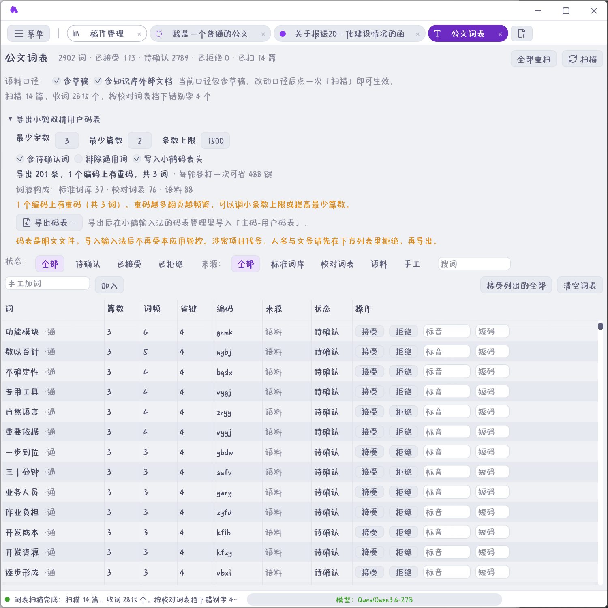

## 公文词表与输入法 {#chap:lexicon}

### 公文词表是什么

「公文词表」页把**长期积累的公文变成输入法词库**，让打字和成文用的是同一套名称。

它是 SQLite 表（与稿件库同一文件），不是配置项。核心循环：

**扫描收词 → 合并标准写法 → 人工确认 → 导出码表 → 导入输入法**



页面自上而下就是这条循环：先定语料口径并扫描，再在导出面板里调参数看省了多少键，最后在列表里逐词定夺。

### 扫描：累积

点「扫描」处理正文变过的稿件：

- **按内容哈希记账**：已扫过且没改动的整篇跳过；
- 同一篇稿件反复保存**不会把词频算重**；
- 默认只统计**已发布与已归档**的稿件，草稿默认不计入（可在扫描选项里改）；
- 扫描有进度条，可随时看处理到哪篇。

范围可收窄（按文种、按状态、按时间），收窄后立即生效。

收词规则：

- **单字与非汉字永不入表**——单字进了码表只是浪费编码空间；
- 词按分词器切出，人名、单位名靠标准词库的用户词典保住整体；
- 重复出现累加**篇数**（不是次数）。

### 合并：标准写法自动进来

扫描时自动并入两类写法，**都置为已接受**：

| 来源 | 并入什么 |
| --- | --- |
| 标准词库 | 单位全称、对外名称、简称、别名、机关代字 |
| 校对词表 | 「建议写法」 |

同时：

- 校对词表里的「**错误写法**」进**黑名单**——既不入库也不导出；
- 所以**不会把写错过的字固化进输入法**。

> [!提示]
>
> 这套合并是双向的：标准词库改了单位名，重扫一遍词表就同步过来。不需要手工搬运。

### 确认：人工定夺

列表默认隐藏输入法词表中已经能输入的同名词，避免重复审阅；「待确认」等统计也排除这些词。
按文字完全相同判断，不要求编码相同，简码也算。基础表、个人词条和已启用的导入表参与判断，
已屏蔽或停用的词不算；公文词表自己同步到输入法的词也不算，避免同步后记录自行消失。
需要查看时勾选「显示输入法已收录词」。隐藏不等于拒绝，不改原有审阅状态；完整码表导出不受此开关影响。
输入法中增删词、启停来源或撤销后，返回本页会自动更新。

扫描结果里每条词可以：

| 操作 | 效果 |
| --- | --- |
| 接受 | 进词库，可导出 |
| 拒绝 | **永久记住**，重扫不再冒头 |
| 标读音/四码 | 人工指定读音或四码，**锁定**，重扫不覆盖 |

**拒绝过的词永久记住**——涉密的项目代号、人名、文号，扫出来就拒绝，下次不会再冒头。

**人工标过读音或编码的词条会锁定**——你花心思定过的编码，重扫不会冲掉。

### 排序：省键数 × 篇数

排序与筛选按**省键数**来，**不按词频**：

- 建议词组编码是**四码定长**：n 字词正常敲 `2n` 键，进用户码表一律 `4` 键；
- 所以省 `2n-4` 键——**二字词省 0 键，默认不导出**；
- 排序权重是 **省键数 × 出现篇数**。

三字词省 2 键、四字词省 4 键，越长越划算。出现篇数多的优先——常写才值得占编码空间。

> [!注意]
>
> 导出默认有**条数上限**：用户码表与主码表合用同一个编码空间，词收得越多重码越多、翻页越频繁。宁可少而精。

### 导出公文四码词表

「导出」生成公文四码词表：

| 特性 | 说明 |
| --- | --- |
| 编码 | UTF-8 **带 BOM** |
| 格式 | 文字、制表符、四码 |
| 重码 | 同时写出**重码报告** |
| 内容 | 只含**已接受**且**不在黑名单**的词 |

导入方法：在「输入法词表」页点「导入… → 公文四码表…」。已接受的词本来就会自动进应用内输入法，导出的码表主要给外部输入法用。

重码报告要看看：同码的词会互相抢候选，翻页频繁。报告里列出冲突对，可以回去拒绝掉不那么常用的那条。

#### 涉密提醒

> [!警告]
>
> 导出的码表是**明文文件**，导入输入法后**不再受本应用管控**。涉密的项目代号、人名与文号请**先在词表页拒绝再导出**。

拒绝是永久的，会挡住重扫再冒头。导出前扫一眼列表，敏感词都拒绝掉。

### 词表的其他用途

也导出**重码报告**与**统计**（收了多少词、省了多少键）。导出文件名自动起（按词库规模与日期）。

即使不开启词表输入法，公文词表依然有用——它同时是**收词统计**与**写法审校**的依据。

### 词表输入法

应用内输入法只按编码查词表，不使用全拼、双拼、整句模型或自动调频。
最终候选来自基础表、公文词表、已启用的导入表与个人词条；同码同词合并，保留来源。

#### 基础表

初始基础表为 `quan.txt`，保留其中的单字、词组、一至三码和四码。
首次运行优先使用用户目录已有的 `ime/base.txt`；没有时从随包 `runtime/ime/base.txt`
或开发资源 `assets/fuma/quan.txt` 载入。旧版导入的音形表也能迁移。

**基础表只读**，只能在「输入法词表 → 导入… → 更新基础词表…」整体导入升级。升级前会列出与当前表的
差异（新增、删除、换位），以及升级后个人层里会多出几条多余或失效的记录。
个人词条、屏蔽与排序全部保留；换回上一版用「撤销上次基础表升级」。

#### 自动出码

加词时编码自动填好。程序从基础表反推两样东西：每个字的编码（取该字两码以上编码的前两码），
和词组的构词规则（用 Rime 的写法，如二字 `AaAbBaBb` 即首字前两码＋次字前两码）。
规则是拿基础表里的全码词组逐条验证、选命中率最高的那组，换成五笔、郑码这类表也一样适用。

多音字会算出几个可能的码，按「这个字的这个码在已有词组里用了多少次」排序，最可能的排第一，
其余列在「其他可能」里点一下即换。规则与命中率在「导入与来源」查看，也可以手动改写。

#### 公文四码词表

「公文词表」中已接受且编码为四码的词，维护后几秒内自动加载。
扫描发现的待确认词不会进入候选。公文词表的编码与输入法加词同源：按基础表推算的构词规则出码，
人工标音只用来在多音字的几个码里挑一个；也可以直接指定四码。基础表未就绪时按小鹤双拼规则出码。

「输入法词表 → 导入… → 公文四码表…」也可直接导入已有四码表：

```text
综合处室	zhcs
```

其中分隔符为制表符，也支持 `zhcs,1=综合处室`。基础表与个人词条接受 1–4 个小写字母，
公文导入表使用四码。UTF-8、UTF-16、GBK 自动识别。
导入前显示新增、已有、重码、重复与无效记录；确认后立即生效。
每份导入表可单独停用或撤销，其他来源的同码同词仍然保留。

#### 加词与造词

- 正文选中文字后右键「加入词表」，或按 `Ctrl+Shift+A`。没有选区时，`Ctrl+Shift+A` 取最近用输入法
  上屏的一段汉字（最多八个），窗口里可以改成取最后两字、三字……
- 加词窗默认只填文字与编码，输入文字自动出码，手改编码也可以；Enter 或「添加」保存，
  「连续添加」清空后接着加。需要看逐字码、其他可能码、已有候选或设首选时，展开「候选与更多选项」。
- 正文右键「查编码」看选中字词的全部编码、最短码与逐字码。

#### 输入法词表页

主菜单「输入法词表」，常用页面只有「词条」和「检查」：

- **词条**：搜索文字或编码，字母按编码前缀查，`?` 通配一个字母；其他文字按包含查。
  来源下拉框可以切到个人词条、导入表或已屏蔽词；码长、字数、重码等在「更多筛选」。
  双击文字或编码就地修改，Enter 保存，Esc 取消。复选多条后点「移除所选」，或按 Delete 移除。
  个人词直接删除，其他来源的词只在个人层屏蔽。默认结果不再显示已移除词，切到「已屏蔽」可恢复。
  行尾「… → 候选顺序与查码」按需查看候选、调序与查码，不占常驻侧栏。
- **检查**：编码不符规则的词可直接「改用建议码」，也可双击编码手改；多条建议可以一起处理。
  冗余和失效记录可以逐项清理；多码与重码可查看后按需调整，无需消除所有重码。
  「忽略」只对本次运行有效，可点「重新显示」找回。
- **导入… / 导出…**：普通导入可直接导入有效词条，无效行会明确提示跳过；
  更新基础表和恢复个人备份先看覆盖范围，再确认。导出默认提供生效词表，也能导出当前筛选或个人设置备份。
- **更多**：查码、导入来源启停、构词规则、最近 20 次个人层修改记录及同步公文词表入口。

加词、修改、移除和处理建议保存后立即生效；点提示旁「撤销」或按 Ctrl+Z 撤回最近操作。
批量移除和批量处理各按一次操作撤销；输入框内 Ctrl+Z 仍用于撤销正在输入的文字。
本次运行的撤销最多保留 20 次，并按快照总量裁剪；退出后通过「更多 → 修改记录」恢复个人层历史。
基础表更新会清空本次撤销栈，旧基础表单独通过「更多 → 导入与来源」恢复。

修改基础表里的词时，程序屏蔽原词、另存一条个人词条，基础表本身不动。
候选顺序只由你显式调整，不根据使用频率自行变化。

#### 按键

小写字母进入编码；普通候选条优先查询表中明确的简码。
空格选高亮、1–9 选当前页候选；只打一码时，候选条只列编码正好是这一码的字词，
设置的翻页键或 PageUp / PageDown 翻页。
退格、Delete、左右与 Home / End 编辑编码；Esc 清码，回车原样上屏编码。
打到两码以上、忘记后续编码时，按向下、下一页或点候选窗右上角的向下箭头，展开按前缀浏览，
不必开启逐码提示。竖排候选时向下先在本页逐个挪，挪到本页最后一个再展开。
展开后是候选网格：每行与候选条一样多格（「每页候选数」），露四行，其余用滚轮或滚动条往下翻；
表头可按全部／单字／词组筛选，点向上箭头收起。上下一次挪一行、左右一次一格，
翻页键一次翻四行；序号只标在高亮所在的那一行，数字选的就是这一行，空格选高亮。
Esc 先收起，再按才清码；继续输入或退格也会收起。
在展开的网格里右键置顶、调序或屏蔽后，网格不收起，筛选和滚到的位置都保留。
单击 Shift 切中英，切到英文时已输入的编码原样上屏。
组码时 `Ctrl+Delete` 屏蔽高亮候选；在候选上点右键可置顶、上移、下移、屏蔽或查编码。

「四码唯一候选自动上屏」默认关闭；打开后单字与词组一致。
「第五码顶屏」默认打开：四码后继续输入字母时，先上屏当前候选，再开始下一编码。
四码没有候选时保留原编码，请退格修正或按 Esc 清码。空格不会把无码字母写进正文。

#### 候选窗

- 公文词表、导入表与个人词条里的词，词后右上角带一颗星；鼠标停在候选上显示来源、编码与位次。
- 编码没有候选时，编码后面标「空码」。
- **简码提示**（默认开）：这个词还有更短的编码时，词后用小字标出，如 `‹vd›`。
- **词组提示**（默认开）：逐字打出的几个字正好是表里的词时，状态栏提示它的编码。
- **逐码提示**（默认关）：二、三码时在精确候选后面列出以它开头的候选，并标出还要打的码；
  一码不列。只是提示：空格仍只上屏精确候选，按数字或展开才选得到它们。
  普通候选条只预览前 18 条；按向下或下一页展开后可浏览全部候选，页数固定。

#### 文件

| 文件 | 内容 |
| --- | --- |
| `config/ime/base.txt` | 当前基础表 |
| `config/ime/base.previous.txt` | 上次基础表 |
| `config/ime/tables.json` | 导入表、个人词条、屏蔽、排序和手动构词规则 |
| `config/ime/history/` | 个人层最近 20 次修改前的文件 |

旧拼音词库、语言模型与学习数据不再使用；旧用户文件不主动删除。
未导入基础表时，中文输入交给系统输入法。
