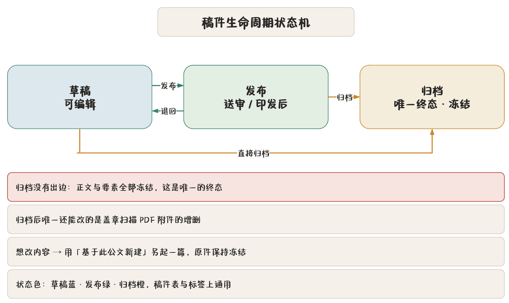

## 稿件库在哪

「稿件管理」页管稿件库（SQLite，`config_dir()/manuscripts.db`）。所有稿件、版本、盖章附件都在这一个文件里，与知识库、公文词表同库。

打开失败不阻塞启动：稿件管理页显示错误，其他功能照常。

## 生命周期状态机

| 状态 | 含义 | 能去哪 |
|---|---|---|
| 新建 | 历史遗留状态，已取消 | — |
| **草稿** | 可编辑 | 发布、归档 |
| **发布** | 送审/印发后 | 退回草稿、归档 |
| **归档** | **唯一终态** | 无 |

- **归档无出边**：归档后正文与要素**全部冻结**；
- 归档后唯一还能改的是**盖章扫描 PDF 附件**的增删；
- 想改内容，只能「基于此公文新建」另起一篇；
- 呈批件挂着送批材料时，归档会把各件**钉在送出去的那一版**，见 [送批材料](chapter:22-send-package)。

发布 → 退回草稿是唯一的反悔路径。状态色：草稿蓝、发布绿、归档橙。

## 列表与筛选

| 能力 | 说明 |
|---|---|
| 筛选 | 按状态、文种、关键字、时间范围 |
| 计数 | 各状态稿件数 |
| 勾选 | 批量操作 |
| 排序 | 按时间、按标题 |

筛选条件变化会自动重查。列表行显示状态点、密级、标题、文种、更新时间。

## 新建三条路

| 路径 | 用途 |
|---|---|
| 新建空白文档（`Ctrl+N`） | 从零写 |
| 从文件新建文档 | Word / Excel / PPT / ODF / RTF / EPUB / CSV / PDF（电子版）转 Markdown，可导 24 种 |
| 从文件夹新建研究报告 | 合并第一层 `.md`；导入正文引用的图片；`.bib` 需在第一份的 frontmatter 里声明 `bibliography:` |
| **基于此公文新建** | 要素连同版式带过去 |

「基于此公文新建」是高频项：同类公文只改事项，比从零填要素省事得多。

### 从文件导入

导入走 `anydoc` 把原文件转成 Markdown，`.md` 与纯文本直接读。**非 Markdown 文件**（含直接读的纯文本）进起草页之前，先做一遍文本规范化，再按公文版式还原结构；两步都是固定规则，不调用模型。

**文本规范化**修的是转换带进来的毛病：

- 中文之间、汉字与数字之间的多余空格删掉（「2026 年」→「2026年」），全角数字改半角；
- 中文语境里的半角逗号、句号、分号、冒号、问号、叹号与括号换全角，数字、西文和网址里的标点不动；
- 转换器留下的目录行、链接、内联锚点、脚注、代码围栏和分隔线清掉，链接只留文字，脚注内容收进正文；
- 表格按表头把每行列数补齐或截断，单元格里的 ` ` 换成「；」，表头为空时把第一行数据提为表头。

**还原结构**只管版式，不猜内容：

- 段首的手打编号「一、」「（一）」取编号后第一句或冒号前的短语作 `##` / `###` 标题，其余留作正文；「1.」「（1）」看版式定性——下面还挂着正文段或下级编号、或每项都是「短标题。长正文」的，转成 `####` / `#####` 标题，一行一条的干条转成列表；「①」一律转列表。Word 自动编号与标题样式同样处理。原编号剥掉，由程序重新编号。
- 一段里的「一是……二是……三是……」拆成一项一行，并把「一是」「二是」到第一个逗号（或句号）之间的前半句加粗。
- 没有编号、单独成段的短标题加粗，不硬猜层级。
- 「第X条」保留为正文段落，条号加粗；「第X章」「第X节」「第X部分」认成标题。
- 开头像公文标题的段落（「关于……」或以文种结尾）升成 `#`（稿子里已有标题时不升）。
- 单独一行的「附件」「附件2」接一行标题改成附件标记，「附件1：名称」这种写在同一行的也认。
- 文首的版头（密级、紧急程度、文号、签发人、份号）与文末的版记（落款、成文日期、抄送、印发机关）会被识别并从正文里剥离，免得与版式重复；这些内容请在要素表单里核对补全。

首句过长等拿不准的段落原样保留，导入后请对照原文核一遍。Word 另存的纯文本按一行一段读；段与段之间留空行的折行文本，会把折行接回自然段。

**图片**：`.md` 导入时，正文引用到的本地图片会一并复制进稿件的 `images/`，文档里存相对路径。Word（docx / doc）、OpenDocument、RTF、PowerPoint、EPUB 里**嵌入的图片**也会取出来入库：PNG、JPEG（以及 GIF、BMP、WebP）按原图保存；Visio 图、旧版 Office 图表这类 **EMF / WMF 矢量图**转成高清 PNG 保存，图里的中文按随包字体（黑体、仿宋、书宋）重画，四周空白裁掉。都命名为「原文件名_图N」，同一张图只存一份。公文里图片必须单独占一行，所以段落中间的图会把段落拆开、单独成段，表格、列表里的图挪到表格或列表之后；图片不带替代文字，原文图下的题注照常留作正文。显示尺寸不保留，预览与导出按版心宽度缩放。

取不出来的图（TIFF、SVG、转换失败的矢量图、链接到外部的图片）在原位置留一行 `<!-- [图片未导入：原因] -->`，导出时不印，状态栏会提示张数，需要从原文件里另存图片后用「插入 → 图片」补上；脚注里的图片直接略过。缺图或格式不支持的图片都不阻断导入。PDF 里的图片仍取不出来。

**电子版 PDF**：起草页「导入文档」与「从文件新建文档」都支持，只提取可编辑文字，**不保留原版式**。PDF 段落间距紧，转换器常把主送、加粗标题、附件说明、落款和版记并成一段；导入时会按加粗编号、主送冒号、附件/抄送/落款标记尽量拆开。导入后请核对段落、标题、跨页衔接、表格及页眉页脚；图片、印章和公式可能缺失。检测到需要 OCR 的页、明显乱码或密码保护时**拒绝导入**，不会跳过这些页继续插入。程序不执行 OCR，也不把文件上传到外部服务。

外部的 txt / csv / md 会自动识别编码：有 BOM 按 BOM，整份是合法 UTF-8 按 UTF-8，否则交给编码探测（GBK 与 Big5 拿不准时偏向 GBK）——GBK、UTF-16 的老文件不必先另存为 UTF-8。程序自己写出的配置与稿件库仍按 UTF-8 读。

> **提示** 导入后还可以在起草页功能区的「清洗」分区再清一遍，见 [功能区](chapter:07-ribbon)。

## 版本

提交版本、版本历史、对照、回退、花脸稿见 [版本、对照与花脸稿](chapter:10-versions)。要点：

- 保存是「现在这样」，提交版本是「这一刻留档」；
- 版本可回退，**回退不清历史**；
- 花脸稿导出改稿痕迹（删字画红色删除线、增字套蓝色方框）送审。

## 盖章扫描件

稿件详情里可挂**盖章扫描 PDF**：

| 特性 | 说明 |
|---|---|
| 一等公民 | 预览可直接打开（PDF 查看器） |
| 归档后唯一可改 | 归档冻结正文与要素，只留附件增删 |
| 批量导出命名 | 自动加「（盖章）」 |

印发环节把盖章件挂回来，归档就完整了。

## ZIP 导出与迁移

「导出 ZIP」把稿件（可多选）打包带走：

| 特性 | 说明 |
|---|---|
| 可设密码 | 密码单独存 `config_dir()/.zip-password`（Unix 权限 0600） |
| **随附词库** | 包内带 `vocabulary.json` **完整标准词库**（含单位、人员与联系方式） |
| 图片随包 | 相对路径的图片一并打包 |
| 送批材料随包 | 默认勾「连同呈批件的送批材料一起导出」：只勾呈批件，函稿、研究报告等随行件也进包 |

导入 ZIP 时：

1. 预览页显示**包内词库规模**；
2. 默认勾选「**合并包内标准词库到本机**」；
3. 合并策略：按**层级编码/姓名**增量合并，**不覆盖**目标机器已有的词条；
4. 取消勾选则只导入稿件。

> **提示** 换机器的推荐姿势：源机导出 ZIP（勾记住密码方便），目标机导入（勾合并词库）。稿件、图片、词库一次到位。

旧版稿件包不带词库，导入不受影响。

**公文引用就是正文文字。** 引用随稿件、历史版本和同步包原样携带，目标电脑没有来源
原稿也能预览与导出。公文登记簿暂不随包携带：那边打开「本篇引用」会显示为未登记，
需要时一键登记即可。来源稿件后来更名、改号，正文不会自己变；打开「插入 → 公文引用
→ 本篇引用」会提示与来源不一致，确认后一键改为来源写法。

## 批量导出 PDF

勾选多篇 → 「导出 PDF」：

- 后台逐篇排版，不卡界面；
- 盖章件自动加「（盖章）」命名；
- 全部打包成一个 ZIP。

适合换季归档一次性出一批 PDF。详见 [导出、打印与文件命名](chapter:11-export)。

## 删除与清理

- 删除有二次确认；
- 删除稿件时**清理孤儿图片**：只删仅被该稿件引用的图片，别的还在用的一律保留；
- 版本、附件随稿件删除；
- 批量删除需单独二次确认；
- 被呈批件用作送批材料的稿件，确认时会列出是哪几件；被**已归档**呈批件用作送批材料的**不能删**。

> **注意** 删除是**硬删**，没有回收站。删之前不确定就先导出 ZIP 备份。

## 自动保存与退出

- 按设置的间隔自动保存打开中的稿件（默认 2 分钟）；
- 退出时汇总确认未保存/未提交的篇目；
- 启动恢复上次全部标签现场。

见 [版本、对照与花脸稿](chapter:10-versions)。
