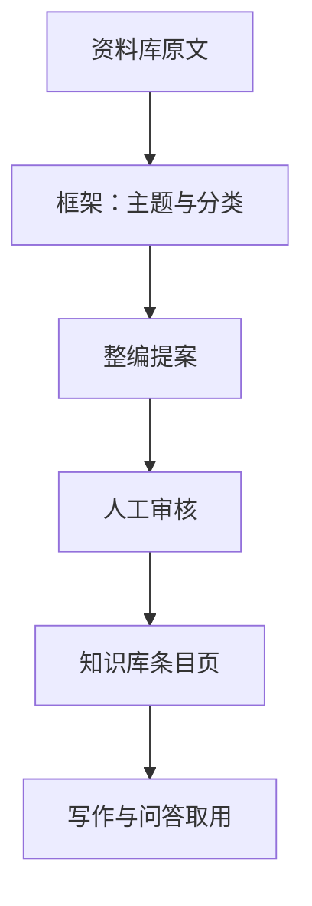

## 知识库（维基） {#chap:wiki}

### 两个库，各管一段

主菜单里挨着的两页各管一段：**资料库**存原材料，按原文检索；**知识库**把材料整编成一条条有框架、能互链、带依据的条目页，供写作时按语义取用。

| | 资料库 | 知识库（维基） |
|---|---|---|
| 存什么 | 导入的文件与库内稿件原文 | 人工审核过的条目页与导览页 |
| 组织方式 | 按文种归堆，全文索引与向量索引 | 主题 → 分类 → 页面，页面之间 `[[双链]]` |
| 检索单元 | 原文片段 | 整页知识综述，附本页依据清单 |
| 谁写的 | 原文作者（你导入的历史材料） | AI 整编成提案，你逐页审核后才入库 |
| 改错怎么办 | 重导原文 | 新版本 + 回滚，历史全量保留 |

两库存在同一个 `manuscripts.db` 里，启用应用锁时与稿件库一起加密。**知识库不搬动、不删除资料库里的原文**：条目页只记「本页依据是哪几篇资料」，删资料时引用它的页面会进「需复核」。

图：资料到条目页的流水线

### 框架：主题与分类，只有两级

框架是一棵两级树：**主题**（一级）下挂**分类**（二级），分类下直接挂页面，分类本身不再分层。每个主题与分类都自带一篇**导览页**，正文里可以用 `[[主题名]]`、`[[分类名]]` 链接过去。

**一页只归一个分类**。跨分类的内容靠页面之间的链接解决，不做多重归属——这样「这页属于谁」永远有唯一答案，整编和更新时范围也清楚。

### 建框架的三条路

点工具栏的**框架管理**进框架工作区，左侧是现有框架树，右侧是节点详情：

| 入口 | 适合 | 过程 |
|---|---|---|
| **从资料归纳** | 冷启动：资料一堆，没想好怎么分类 | Pi 用只读工具翻资料库，交回「主题 / 分类 + 依据文档」的框架提案；通过校验后进「框架提案」页，可增删节点、改名、同级上下移、调整分类归属，点**确认框架**才写入 |
| **导入大纲** | 已有现成框架 | 粘贴 Markdown 大纲——`# 主题` / `## 分类`，或两级列表，可混排；对话框里实时预览，确认写入。同名节点跳过不覆盖 |
| 手工维护 | 边用边补 | 树里直接新增主题、新增分类、行内改名、上移下移、把分类**移到主题**、移除节点 |

框架有规模上限：至多 30 个主题、每主题至多 20 个分类，节点名不超过 60 字。大纲里的第三级、重名分类、没有主题的孤儿分类会直接报错，不会悄悄丢一半。

> [!注意]
>
> 「从资料归纳」是 **Pi 作业**，需要先配好「AI 管理 → 模型服务 → 智能写作（Pi）」，并让随包运行时可用。归纳只读资料库、只交提案，**不会自己写进框架**；点「丢弃提案」什么也不发生。

### 整编：把分类写成条目页

在框架树上对某个分类点**整编此分类**（主题上点**整编主题导览**），发起一次整编作业：

1. Pi 读该分类名下的资料原文（`kb_read`），判断这一类该拆成几个主题页；
2. 逐页写成综述正文，行文里用 `[[页面名]]` 链到相关页面——链到资料里有、维基还没有的概念时先写成**待建页**（红链）；
3. 每页附**依据清单**：出自哪几篇资料、各自支撑哪些要点，正文关键处标〔E1〕〔E2〕；
4. 交回 JSON 提案，程序复核结构、标题、归属分类、依据是否真实存在，通过后进**待审收件箱**。

一次整编最多 10 页、单页正文 2 万字、页标题 100 字以内、依据说明每条 200 字以内、单个分类最多挂 50 篇依据。**作业不占写作门禁**：它在后台跑的时候，起草页照样能开自己的 Pi 写作，两边同时跑互不干扰。

### 审核台：逐页把关，可以直接改正文

工具栏的**待审收件箱 N** 里按批次列出提案：每批里有几页新建、几页更新，各自依据几条、审到哪一步。

进**人工审核**后整个中间区域就是审核台：

- 左边是可编辑的 Markdown 源码，右边是版式预览，和起草页看到的是同一套排版；
- 更新提案可切到**变更对比**，对着 `v3 → 提案` 看改了什么；
- 右栏默认看**依据**，点正文里的来源编号就地读原文开头，需要时打开全文；也能切回本批的 **AI 工作状态**复看运行记录；
- 底栏固定**退回**、**采纳并入库**，同批条目用 `‹ 上一篇` / `下一篇 ›` 翻；一页不过可以**全部退回**。

采纳由界面线程写库：页面入库或生成新版本，链接边按标题解析登记，依据落成资料文档的确认标记。你改过再采纳的版本会标**经人工编辑**，来源记着这轮作业的运行标识。

> [!注意]
>
> 发起之后如果页面在库里又被改过（版本已经往前走），审核台会提示「当前版本已变化，请退回并重新发起」——不在旧基线之上盲写，免得把后改的内容冲掉。

### 更新已有页面

阅读器页头的**更新**按新资料改写当前页：Pi 拿到这一页的现状与分类范围，找资料库里相关的原文改写正文，交回整页新正文。一次更新至多 5 页；**更新不改名、不改页面类型**，新正文必须与现状确有不同，依据必须是真实存在的资料。审核台上更新提案显示 diff，采纳同样生成新版本。

### 缺口清单：该补的地方一页纸列清

工具栏的**缺口清单**是维护抓手，四类分开列：

| 区块 | 含义 | 一键处理 |
|---|---|---|
| 需复核 | 本页依据对应的资料已删除或替换 | 打开页面核对，或对它发起更新 |
| 缺导览页的节点 | 主题或分类还没有导览页 | 整编导览 |
| 待建页（红链） | 正文里链了但还没建的页面，列出引用来源 | **建此页**：标题固定、手选归属分类、自己写正文，来源记为人工 |
| 还没有条目页的分类 | 分类是空的 | 整编此分类 |

红链会随建页自动收敛：新建页面对上标题后，原来指向它的红链就地变成正常链接，不用回头改旧页。

### 阅读器、链接与版本

中间是阅读器，左边的树按主题 → 分类 → 页面展开，右边窄栏常驻**被引用 / 依据**（窄窗口下可折叠）。

- 正文里的 `[[页面名]]` 直接点开；没建的页面显示为红链。标题、公式与部分表格里的链接在右栏的**本页链接**里同样能点。
- **被引用**列出哪些页面引用了本页，以及引用它的那句原文。
- **依据**按 E 编号列出资料与支撑说明，可直接读原文。
- 页头的**改名**全库跟随——页面背后是唯一 ID，改了标题，所有指向它的链接自动对上。**删除**受保护：被别的页面引用的页面删不掉，得先处理引用；删除会连同该页全部版本历史一起消失，二次确认后才执行。
- **版本历史**：左侧列出版本号、时间与采纳方式（AI 作业 / 人工建立 / 经人工编辑），中间任意两版对照，右栏看所选版本的来源与依据；**回滚**不抹除历史——从旧版生成一个新版本，历史照样全在。

### 和资料库联动

资料库列表多了一列**维基**：`未整编` 表示还没被任何页面引用，`已用于维基 N 页` 列出具体页数。列表可按这一列筛选，工具栏的**圈选整编（N）** 把勾选的资料圈成一批，选定目标分类后交给整编作业——先有材料、后建框架的情况下走这条捷径。

新导入的资料若标题命中了维基里的页面，资料库会挂一条**按新资料更新**的提示，点一下就对关联页发起更新提案（提示关掉后不再打扰）。

### 写作与问答怎么用这些条目

Pi 写作时取料的顺序是**先维基（语义导航）→ 再原文 → 兜底资料库检索**，用的是四个只读工具：

| 工具 | 干什么 |
|---|---|
| `wiki_search` | 按写作任务的语义检索页面，给标题、分类路径与摘要 |
| `wiki_read` | 读页面全文，长文按字符分页续读 |
| `wiki_links` | 列出本页出链候选（标题 + 一句话摘要），只作下钻方向，不是必读清单 |
| `wiki_doc_read` | 按本页依据清单读原始资料的对应段落 |

维基工具另有每轮 12 次的独立额度，跟写作工具的额度分开，防止语义下钻把写作预算吃光。每次命中自动登记证据台账——交付闸门只认台账里的东西。任务助手的材料整理与表单填写也能用这四个工具。

资料库的问答改成**维基优先双层**：先按提问检索至多 3 篇维基页（每篇取前 3000 字），已审核的条目知识优先；资料库原文片段兜底补细节。两类资料口径冲突时，回答会分别标出处、说明差异，不合并成一个结论。答案卡片下方列出**维基依据**，点一下跳到知识库并打开那一页。

> [!红线]
>
> 维基条目是**已经人工审核的知识综述**，不是事实权威的替代品。写进公文里的单位、人名、日期、数字仍按原规矩核实；审核台上看到正文与原文口径不一致，以原文和你的判断为准——这正是审核台必须人工逐页过的原因。

### 起步建议

1. **先把资料库装满**：整编的料来自资料库原文，料不够，条目页只能空转；
2. **框架宁可粗一点**：先从资料归纳出 3–5 个主题，用起来再补分类，别一上来铺几十个空分类；
3. **一批一批整编**：一次一两个分类，审核台才好过；整编批次越大，退回来的返工越贵；
4. **每页都看一眼依据**：条目页长期给写作供料，错一页会一路污染到成稿；
5. **用缺口清单收尾**：红链该建的建、空分类该整的整，别让「待建页」越积越多。
