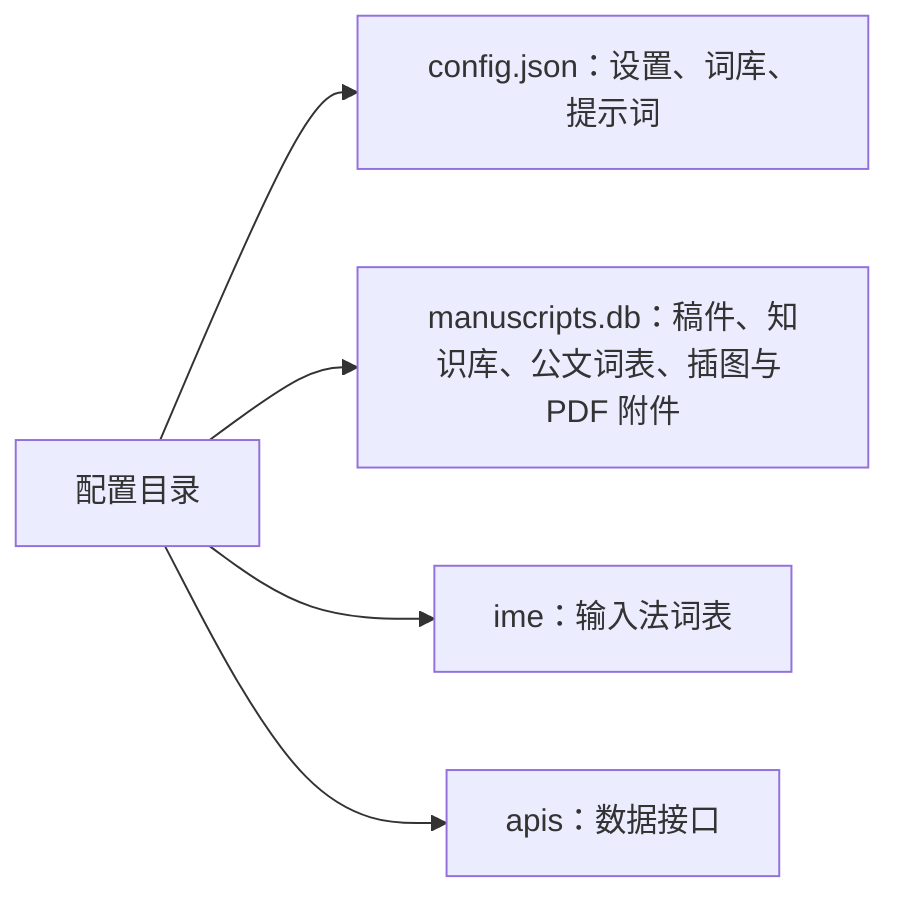

## 数据、备份与迁移 {#chap:data}

### 数据都在哪

程序的所有数据在**系统配置目录**的 `LocalTools/GongwenAssistant/` 下：

| 内容 | 路径 | 说明 |
|---|---|---|
| 配置 | `config/config.json` | 词库、提示词、设置、模板默认要素 |
| 稿件库 + 知识库 + 公文词表 | `config/manuscripts.db` | **三者共用一个 SQLite 文件** |
| 记住的稿件包密码 | `config/.zip-password` | 仅启用应用锁后允许保存，整份加密 |
| 诱饵系统的稿件库 | `config/alt-manuscripts.db` | 设了第二密码才有；与主库同构但内容独立 |
| 插入的图片与 PDF 附件 | `config/manuscripts.db` | 资源 BLOB、原文件名和媒体类型都在库内 |
| 图表（Mermaid）缓存 | `config/manuscripts.db` | 与插图共用资源表；命中不了就重画 |
| 智能写作（Pi）工作目录 | `config/pi/` | 每轮运行记录、材料、交付与长会话 |
| 输入法基础表与个人词表 | `config/ime/` | 基础表、导入表、个人词条、排序与屏蔽 |
| 检查器埋点 | 单独文件，不进 config.json | 只留本机 |
| 数据接口配置 | `config/apis/services.json` | 各服务集中存储，启用应用锁后整体加密，服务名不再进入文件名 |
| 各服务的服务器地址 | `config/api-envs.json` | 一个服务一份地址 |
| 密钥名与值 | `config/api-secrets.json` | 只存在本机，不导出、不发给模型 |
| 接口测试记录 | `config/api-tests.json` | 只存用例结论与配置指纹，**不存返回内容** |
| 崩溃日志与损坏配置留底 | `config/logs/`（诱饵密码槽位为 `config/alt-logs/`）、`config/config.json.损坏-*` | 只用于本机排查，落盘即加密，**不进全量备份** |

设了第二密码时，诱饵系统用同构的 `alt-` 前缀目录（如 `alt-pi/`、`alt-ime/`），
两套数据各归各位，谁也读不到谁的那份。

图：数据目录结构

公文引用快照保存在本篇 Markdown 中，随稿件与历史版本入库，无需另拷引用数据库。
换机器使用稿件库离线稿件包（`.gwx`）；单篇就能携带引用信息，同时带走来源稿件即可恢复来源查看。
普通 Markdown 主文件与外部复制只保留展开文字，继续管理引用应使用源码包的
`-可编辑.md` 或离线稿件包（`.gwx`）。

### 启用应用锁后的磁盘形态

启用密码保护后（见第{@chap:settings}章「应用锁」），磁盘上的形态变了：

| 内容 | 磁盘上是什么 |
| --- | --- |
| 稿件库 | **密文**（SQLCipher 整库加密，文件头不再是 `SQLite format 3`） |
| `config.json`、`.zip-password`、`api-secrets.json` | **整份加密**的文件（自定义密封格式，不是明文 JSON） |
| 插入的图片、PDF 插图与图表缓存 | **密文**（进入 SQLCipher 资源表，原名称、类型与内容一并保护） |
| 智能写作（Pi）的工作目录与长会话 | **密文**（数据密钥只经标准输入交给宿主，不进命令行参数、环境变量与日志） |
| 个人词表、历史快照、自定义技能、使用统计与诊断日志 | **密文**（详细诊断只在已解锁的提示框里看） |
| 数据接口定义（`apis/`）与风格档案 | **密文** |
| 模板等不含用户数据的内置资源 | 不变 |

全量备份要求先启用应用锁并完成加密。内部保留密文，外层另用独立密码加密 7z 的内容和文件名；恢复时需要备份密码，恢复后还要使用备份当时的应用锁密码解锁。

诱饵系统的库单独放在 `alt-manuscripts.db`，同样是密文、同样独立。

各平台典型位置：

| 平台 | 配置目录 |
|---|---|
| Windows | `%APPDATA%\LocalTools\GongwenAssistant\config\` |
| Linux | `~/.config/gongwenassistant/` |
| macOS | `~/Library/Application Support/cn.LocalTools.GongwenAssistant/config/` |

> [!提示]
>
> 程序内置配置文件在**用户配置目录**，不在安装目录。所以卸载重装**不丢数据**——除非你主动删配置目录。

### 随包资源 vs 用户数据

| 随包（装在程序目录） | 用户（在配置目录） |
|---|---|
| 公文字体（`font/`） | config.json |
| 排版模板（编进程序） | manuscripts.db |
| 初始基础词表（`runtime/ime/base.txt`） | ime/ 基础表与个人词表 |
| 研究报告字体（`runtime/fonts/`） | |

卸载时随包资源随程序走，用户数据留下。

### 输入法数据

`config/ime/base.txt` 是当前基础表，`base.previous.txt` 保留上次基础表；
`tables.json` 保存导入的公文表、个人词条、屏蔽与顺序。
备份时保存整个 `ime/` 目录，也可在词表管理中导出最终词表与个人备份。
旧 `dict.qj`、`lm.qj` 与拼音学习数据不再使用。

### 明文与名称保护的边界

首次选择不启用应用锁，必须确认稿件、人员资料、模型密钥等将以明文保存的风险；
普通模式不能记住稿件包密码。以后再启用加密也不能保证擦除 SSD、系统备份或快照中的旧副本。

启用应用锁后，Pi 的工作文件与技能快照、自定义技能的逻辑文件名和内容一起保存在
加密容器中；双击稿件包时的进程转交只通过本机内存通信，不把业务路径写入收件文件。
文件大小、修改时间以及应用中性的目录结构仍然可见。

复制或剪切内容到系统剪贴板前会确认风险：系统历史记录、跨设备同步或第三方工具可能
保存副本，应用锁无法撤回。剪切取消时不会删除源文字。恶意软件读取已解锁的进程、系统
交换文件、休眠、崩溃转储、截屏和外部模型服务的留存，需要操作系统及服务商侧另行保护；
本机文件加密不等于全盘加密，也不能控制外部软件。

### 应用内一键备份与恢复

设置页「文件与现场 → 数据备份」提供两个按钮，日常备份与换机器都不必再手工复制目录。

| 按钮 | 做什么 |
|---|---|
| 导出备份 | 选一个**配置目录之外**的位置，把有效数据打成一个内容与文件名均加密的 7z；完成后状态栏显示文件大小 |
| 恢复备份 | 选新版 7z 并输入备份密码，校验后列出概要，二次确认后才替换数据；不支持旧 ZIP 备份 |

导出前会保存所有已修改的稿件，即使已关闭自动保存；任一保存失败都会取消导出。
备份与恢复须等后台任务（含公文词表扫描）结束后再进行。

备份包含 `config.json`、`manuscripts.db`、`apis/`、`ime/`、`skills/`、`pi/`、`styles.json`、`metrics.json` 等
配置目录内的有效数据；插图、PDF 附件与图表缓存随稿件库一起进 `manuscripts.db`，不再单独成目录。
备份**不含** `logs/` 崩溃日志、`.unseen-crash` 崩溃提示标记和
`config.json.损坏-*` 损坏配置留底——这些只对本机排查有用，恢复后反而可能让程序误报。

备份密码不保存在本机，遗失后无法恢复。恢复暂存阶段只写密文（公开帮助截图除外），不生成明文数据库或业务文件。外层文件名和总大小仍可见，请用中性名称，并妥善保管两种密码。

恢复的边界：

- 恢复前先把当前配置目录整体改名为同级目录
  `GongwenAssistant-恢复前备份-<时间戳>`，改名失败就中止，现有数据不动；
- 解压中途失败会删掉半成品，并尝试把留底目录改回原处；若改回也失败，
  错误信息会给出留底目录位置；
- 恢复期间程序会关闭本地数据库连接，并用独占模态窗挡住其他操作；
- 恢复完成后**立即退出并重新打开**，避免当前内存里的旧数据覆盖恢复结果。

> [!警告]
>
> 加密 7z 备份里有完整标准词库（含人员电话）和接口密钥，按敏感材料保管，不要放进公共网盘或代码仓库。

### 备份建议

应用内「导出备份」已经覆盖下面整份清单。只有在程序打不开、需要人工抢救数据时，
才按这些条目手工复制。

#### 最小备份（日常）

只备份**配置目录**：

- `config.json`（词库、提示词、模板默认要素）；
- `manuscripts.db`（稿件、版本、知识库、公文词表，以及插图、PDF 附件与图表缓存）；
- `apis/`（数据接口配置）；
- `api-envs.json`（各服务的服务器地址）；
- `api-secrets.json`（密钥名与值）；
- `api-tests.json`（用例结论与配置指纹）。

前三样齐了，换机器就能完整恢复；要用数据接口，后三样也一起带上。

> [!注意]
>
> **密钥不导出**：「导出为 OpenAPI…」出来的文件里既不带密钥，也不带本机环境地址。换机器后密钥要在目标机重新填。

#### 完整备份

用设置页「文件与现场 → 数据备份 → 导出备份」即可；它包含配置目录里的全部有效数据（含 `config/ime/` 的基础表与个人词表）。输入法词表丢了不致命，但自定义的词条与屏蔽项要重新录。

#### 单篇迁移

用**稿件包（`.gwx`）**：一律加密，**随附完整标准词库**（`vocabulary.json`）。目标机导入时默认勾「合并包内标准词库到本机」，按层级编码/姓名增量合并，**不覆盖**已有的。

见第{@chap:manuscripts}章「稿件管理」。

#### 词库单独备份

「标准词库」页「导出 Excel」存一份。注意 Excel **导入暂不支持**校对词表（那边带条件与正则，Excel 表达不全）；校对词表导出 Excel 只作备份与分发。

### 换机器

推荐流程：

1. 源机：设置页「数据备份 → 导出备份」，存一份全量 7z；
2. 源机：导出**稿件包**（`.gwx`，勾记住密码方便），单篇迁移时用；
3. 源机：「标准词库」导出 Excel 双保险；
4. 目标机：装好程序（含运行时）；
5. 目标机：设置页「数据备份 → 恢复备份」，选第 1 步的 7z；程序会自动留底目标机原有数据；
6. 目标机：需要单篇时再双击稿件包导入（勾合并词库）；
7. 目标机：核对标准词库与模型接口地址。全量备份已带过配置，通常不必重设；换网络环境时再改。

### 配置示例

`config.example.json` 是**配置模板**（示例），不是你的实际配置。想看配置结构、想手工改配置，参照它。

`config.json` 与 `.env*` **不入库**（示例配置 `config.example.json` 是模板）。

> [!警告]
>
> `config.json` 里有你的**完整标准词库（含人员电话）**。分享配置文件前先删敏感字段，或只分享 `config.example.json` 这类模板。

### PDF 排版

PDF 由程序内置的 **Typst** 引擎直接排版，公文与研究报告都是，完全离线，不依赖本机装任何排版软件。版式模板编进程序本体；字体来自程序目录下的 `runtime/fonts/`（公文另可在设置里换本机字体）。

### 清理

| 想清 | 怎么做 |
|---|---|
| 孤儿图片 | 删除稿件时**自动清理**（只清仅被该稿引用的） |
| 输入法词表与个人词条 | 删 `config/ime/`（不影响程序运行，但自建词表与屏蔽项会丢） |
| 检查器埋点 | 删埋点文件 |
| 数据接口配置 | 删 `config/apis/`（接口定义没有了） |
| 密钥 | 删 `config/api-secrets.json` |
| 全部数据 | 删整个配置目录（**不可逆**） |

> [!提示]
>
> `apis.json.bak` 是旧版自动迁移时留下的备份，**程序不再读取**。接口迁到 `apis/` 之后它就没用了，可以删。

> [!警告]
>
> 删配置目录 = 删全部稿件、词库、知识库。删之前确认备份在手。

### 隐私

- **不联网**：模型接本机 LM Studio / Ollama，稿子不上传；
- **埋点只留本机**：检查器使用统计单独存文件，不上传；
- **稿件包密码**（勾了记住时）记在本机权限受限文件；
- 「关于」里那句话是认真的：**本软件为内部使用工具，所有数据仅保存在本机。**
