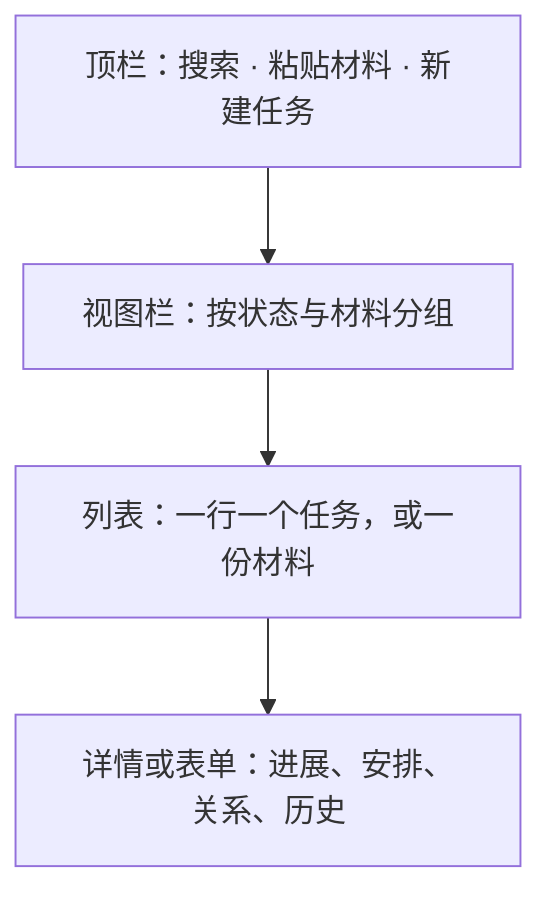
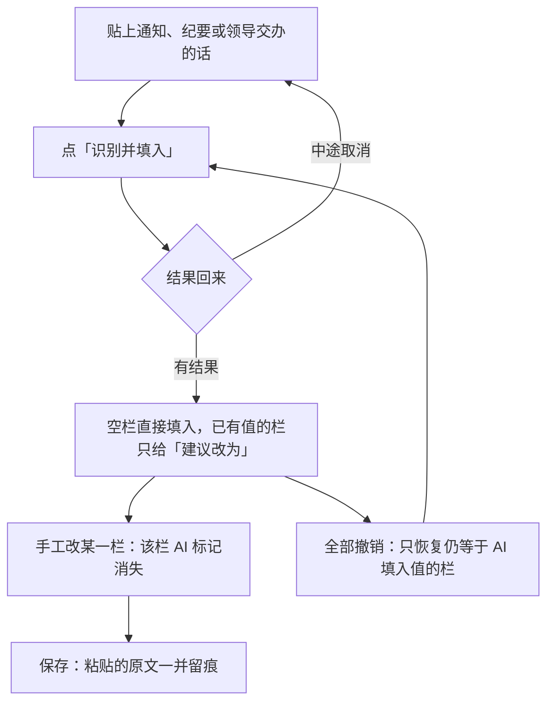

## 任务助手 {#chap:task-assistant}

### 它是干什么的

「任务助手」管的是**手上这些事**，不是公文本身：交办的事、要跟进的期限、别人等着的回复，一条一条记下来，谁负责、当前进展如何、下一步做什么、什么时候到期，走到哪一步都有记录。

它和写公文是两条平行线：

| | 管什么 | 存在哪 |
|---|---|---|
| 起草页 | 公文正文、表单要素、版本 | 稿件库里的稿件与版本 |
| **任务助手** | 任务、进展、来源材料、候选建议 | 稿件库同一 `manuscripts.db` 里的独立表 |

任务数据**不接触公文正文，也不写表单要素**；反过来，改公文也不会动任务。两边共用同一个数据库文件，所以备份、恢复一次带走。

> [!提示]
>
> 手工记任务完全不依赖模型：新建、编辑、记进展、完成、归档都不需要配 AI。只有「从文字填写」与「待整理建议」这两条**粘贴一段话让程序拆**的路才用模型，用的是 AI 管理里配的辅助模型。

主菜单点「任务助手」进入，它是一格标签，可以和稿件、帮助并排切换。

### 三栏骨架

图：任务助手的三栏与顶栏

三栏各自滚动，整页不滚：

| 宽度 | 布局 |
|---|---|
| ≥ 900 | 视图栏 + 列表 + 详情三栏并排 |
| 650–900 | 视图栏收成列表上方的一个下拉框，列表与详情仍并排 |
| < 650 | 列表与详情单栏切换，详情左上角有「‹ 返回列表」 |

顶栏只有三样东西：全局搜索（匹配任务名、负责人、当前进展、下一步、风险与关联材料的原文，**搜索时不受当前视图限制**）、「粘贴材料」、「＋ 新建任务」，以及「更多」菜单（管理分类、新入库资料自动整理开关、显示已处理的建议）。

错误与提示就地显示：一次性提示是页面底部的浮条，几秒后自动消失；表单校验错误写在保存按钮上方，状态切换失败写在状态下拉旁边，识别结果写在「识别」按钮同一行。

### 视图栏：按「这事现在什么状态」看

视图栏取代了原来的「视图 / 状态 / 包含归档」三个控件——状态由视图表达，列表里每行另有状态小标。

| 条目 | 含义 | 数字颜色 |
|---|---|---|
| 今天与逾期 | 任务期限不晚于今天，且未结束 | 逾期数用红色 |
| 进行中的工作（默认） | 未结束、未归档、未删除 | 不着色 |
| 等待 · 阻塞 | 状态是等待或阻塞，或前置还没完成 | 不着色 |
| 待核对 | 被标了「待核对」的任务 | 橙色 |
| 待整理建议 | 状态为待核对或稍后的候选建议 | 强调色 |
| 材料 | 识别过的材料，可看原文、重新识别与删除 | 不着色 |
| 已结束 | 其下是已完成、已取消、归档、回收站 | 不着色 |
| 分类 | 每个分类一行，点一下按分类过滤；末行「管理分类…」开弹窗 | 不着色 |

归档与回收站是**视图**，不再需要一个「包含归档与回收站」的勾选框。归档与回收站里的任务只读。

### 列表：一行一个任务

- 第一行是任务名，第二行是下一步（带期限），第三行用淡色文字写「负责人 · 状态 · 分类」（按分类过滤时不写分类；负责人不在词库时用警示色）；
- 标签只留给要人一眼看到的情况：**待核对、阻塞、有风险**，不再把负责人与分类也做成同样的标签；
- 右上角只放**最要紧的一个期限**：逾期（红）> 今天到期（橙）> 普通日期；
- 表头把视图数量、负责人筛选与「按期限 / 按更新」排序并成一行；中栏窄于 400px 时筛选换到下一行，视图栏收成下拉框时表头不重复视图名；
- 列表为空时给的是邀请，不是空白页：「新建一个任务」或「去粘贴材料」。

### 详情：一个任务的全貌

详情按「一眼要看的」到「事后回溯的」排下来：

| 区块 | 内容 |
|---|---|
| 头部 | 任务名、状态下拉、编辑、「更多」（归档、移入回收站；归档只对已完成或已取消的任务开放） |
| 待核对横条 | 写明原因（取最近一条「依赖复核」或「采纳材料建议」的历史摘要），右侧「已核对」一键清除并记历史 |
| 事实条 | 负责人、任务期限（逾期时标红并写「已逾期 N 天」）、分类；空值写「未设」，窄了自动折行 |
| 正文三块 | **当前进展**、**下一步工作**、**风险问题及应对措施**，都用正文字号；风险有内容时标题旁挂「有风险」标签 |
| 关系 | 上级、前置、子任务、后续各以小标排一行，点一下跳到对方；没有关系时整块不显示 |
| AI 建议 | 只列属于本任务的待核对候选 |
| 历史 | 时间线：左列时间，右边动作与说明，同一基线，标出「n 条，新的在前」；带来源的条目有「原文」按钮，点开是当时的材料快照，不受原资料后来修改影响 |

**当前进展就地改**：平时按正文显示，点「更新进展」变成输入框，`Ctrl+Enter` 更新、`Esc` 或「取消」放弃；旧进展留在历史里（记一条带时间的「进展更新」），不再像以前那样在键值行和输入框里重复显示同一个值。没改动就不写历史。

选「已取消」时会就地要求填写理由——理由是取消的必要信息，不是可选项。

### 表单：新建与编辑

表单在右栏里打开，内容自己滚动，**保存与放弃固定在底部**。字段按常用程度分三组：

1. **要做什么**：任务名称\*（唯一必填）、负责人；
2. **进展与安排**：当前进展、下一步工作、风险问题及应对措施、状态、任务期限；
3. **更多设置**（默认折叠，编辑已有任务且有值时展开）：分类、上级、前置。

一段任务通常就这五项：**任务名称、负责人、当前进展、下一步工作、风险问题及应对措施**；状态与任务期限留给人安排。早先的「目标 / 完成条件」「我的角色」「协作分工」「下一步期限」不再出现在界面上（旧库里的列不删，老库按缺列自动迁移）。

任务期限是文本框加一枚日历按钮：日历弹出中文月历，可翻年月、点日期即填，另有「今天」与「清除」；文本框照常可用输入法键入。任务期限晚于上级任务期限时，字段下方给出提醒。

前置任务用「已选小标 + 搜索添加」：输入框按名称过滤未删除、未归档、非自身的任务，最多列 8 条；已选的以小标显示，点叉去掉。

表单里有未保存内容时再点「新建任务」不会变灰，而是问「当前表单未保存，放弃并继续？」——不让人在不知情的情况下丢掉刚填的东西。

### 负责人：只能从标准词库里选人

负责人是这个任务的实际负责人，不是「我的角色」里的「负责」，所以只从**标准词库的人员**里选：

- 搜索框认姓名、职务、单位与别名，输入即筛，最多列 8 条；
- 同名不同单位的人分列显示（姓名 + 职务 + 所属单位），选中人员时**所属单位随人带出**，不单独填单位；
- 存的是词条身份与选定当时的姓名快照：词条后来改名、换了单位甚至被删掉，任务里仍显示当时的姓名，并标「词库中已没有此人」等人核对；
- 负责人不在词库或出现同名时，其余字段照常保存，只把这一项留空并提示，必须由人选词条后才能算填好。

词库本身怎么维护见第{@chap:vocabulary}章。

### 从文字填写：贴一段话，填一张表

新建任务时表单顶部就是「从文字填写」块（编辑已有任务时收成一行「从文字补充…」），把通知、纪要片段或领导交办的话粘进去，点「识别并填入」。

图：单任务「从文字填写」的过程

填的是**六栏**：任务名称、负责人、当前进展、下一步、任务期限、风险问题及应对措施。要的是「有啥填啥」：原文里有的才填，没有就空着，一次就能把话录完，不必为了保存去凑字段。

填入规则只有四条：

- 目标栏是**空**的 → 直接填入，字段边框与右侧 `AI` 小标用强调色，鼠标停在上面能看原文摘录；
- 目标栏**已有值**且建议不同 → 不覆盖，字段下方出现「AI 建议改为：…　[替换] [忽略]」；
- 手改过某栏 → 那一栏的 AI 标记自动消失（以当前值不等于填入值为准）；
- 表单底部汇总一句「AI 填了 5 栏，2 栏有不同建议」，带「全部撤销」——只恢复仍等于 AI 填入值的栏，人工改过的保留。

**负责人不外由模型自由发挥**：模型只从原文里挑出人名，程序再拿标准词库的姓名与别名去匹配，唯一命中才落词条并带出单位；同名或词库里没有这个人时，提示原文提到的是谁，由人在搜索框里选。分类、上级也不替人凭空造。

保存时只要这一份表单用过 AI 填写，粘贴的原文会连同任务一起落库（同一正文复用同一条来源），历史里就能点回当时的原文。

一段话里提到好几件事时，块底会提示「这段文字里还有 2 件事」，点「转到批量整理」把同一段原文交给下面的「待整理建议」，本表单内容保留。

> [!注意]
>
> 证据必须能在粘贴的原文里找得到：比对时忽略空白与全半角标点差异，但日期必须是真实存在、且在原文里有出处的日期。核对不上的栏**逐栏丢弃并计数**（提示「n 栏因无法核对出处已丢弃」），而不是整批作废——贴一段长话换一张表，整批失败太贵。

### 待整理建议：一段材料拆成多条

视图栏点「待整理建议」，或顶栏点「粘贴材料」直接跳到这里并聚焦原文框。

上面是材料输入：标题（**选填**，留空就取原文首个非空行、去首尾标点、截前 30 字；首行过短时用「粘贴材料 MM-DD HH:MM」）、原文多行框、「识别」；右边可从知识库选一篇已有资料。

下面是候选，**按来源材料分组**，组头写明材料标题、时间与条数，带「查看原文」与「本组全部忽略」。每张候选只显示这一类该看的字段，并排给「当前值 → 建议值」：

| 候选类型 | 显示什么 | 主按钮 |
|---|---|---|
| 新增任务 | 任务名称、负责人、当前进展、下一步、期限、风险与应对措施 | 编辑为新任务（在右栏打开预填表单） |
| 进展反馈 | 目标任务；当前进展、下一步逐行「旧值 → 新值」，可就地改新值 | 采纳 |
| 负责人调整 | 目标任务与建议负责人；词库里对得上才给词条，对不上就地搜人选 | 采纳 |
| 风险变化 | 目标任务与风险文本 | 采纳 |
| 期限调整 | 目标任务与建议期限 | 采纳 |
| 相关意见 / 待决事项 | 提出主体、针对事项、原意 | 记入历史 |

次按钮统一是「稍后」与「忽略」。每条候选都留着当时的**材料快照、SHA-256 指纹与真实存在于原文的摘录**——摘录核对不上就不出这条（较长的正文字段可以顶替摘录，人名、日期这类短值不行）。目标任务为空时，卡片顶部给一个搜索下拉自己选，或者「建成新任务」；模型只能在识别时给它的上下文里挑目标（最近 50 项未归档、未删除的任务），选不出来宁可不提。

- 采纳前若目标任务已经被改过，会以过期拦下，卡片上这时才出现「以当前版本重新核对」；
- 一次采纳里，任务变更、来源历史与候选的「已采纳」状态在同一个事务里完成；
- 模型说某任务「已完成」只是建议，**程序不会自己闭合任务**；
- 已采纳与已忽略的记录从「更多 → 显示已处理的建议」查看，忽略过的可以恢复。

「更多」里另有「新入库资料自动整理」开关，默认关闭，只排队处理开启之后新入库的资料，不会回头扫旧库，也**不会自动采纳**任何建议。

> [!警告]
>
> 「待整理建议」只改候选与草稿，保存或采纳永远由人点。识别结果里的意见与待决事项会记进历史，不会自己变成任务的状态或期限。

### 材料库：识别过的材料有地方放

每识别一份材料，原文就存在「材料」视图里（不另存一份到别处，直接在任务库里）：

- 中栏是材料卡：标题、识别时间、来源（粘贴 / 知识库）与「待核对 n · 已采纳 n · 已忽略 n」；搜索框按标题过滤；
- 右栏是这份材料的**原文快照**与它产生的建议，顶部三个动作：「重新识别」「在待整理建议中查看」「删除」；
- **重新识别**只替换这份材料还没处理的建议（待核对、稍后）；已采纳、已忽略的保留，相同的不重复生成，结果说明新增、替换、跳过各几条；
- **删除**连同未采纳的建议一起删；已被任务历史或已采纳建议引用时只把材料藏起来，快照留着，历史里的「原文」照常能看；
- 粘贴一份**识别过**的材料不会调模型：输入框下方出卡片，写着识别时间、上次各状态的数量，可「重新识别」「查看这批建议」「打开材料」；
- 待整理建议可以只看一批：「只看『材料标题』的建议 · 显示全部」。

「从文字填写」用的原文不列在这里（它属于那张表单的留痕，看任务历史即可）。

### 关系与完成，由程序判定

任务是有关联的：上级、前置、子任务、后续。判定统一按**完成依赖**的方向做——任务指向前置，上级指向子任务。

| 规则 | 结果 |
|---|---|
| 自引用、循环、「子任务依赖上级」造成的死锁 | 程序拒绝保存，不靠人自己看 |
| 进入进行中或完成 | 所有前置必须已完成且已核对；取消前置不算完成 |
| 完成上级 | 所有子任务都必须已完成（取消不算） |
| 重开一个前置 | 进行中的后续任务标为阻塞 |
| 完成后果被重开影响 | 标「待核对」，但**不撤销已发生的事实** |
| 删除任务 | 先展示将解除哪些关系；确认后**不级联删除**：子任务变独立，后续任务解除该前置并标待核对 |

分类单层，一个任务只有一个主分类。新增与改名都校验唯一；删除分类必须先指定迁移目标，迁移覆盖活动、归档与回收站里的任务并记历史。

### 上限与数据安全

| 项 | 上限 | 超了以后 |
|---|---|---|
| 单份材料原文 | 1 MB | 提示，不入库 |
| 材料快照合集 | 1 MB | 提示 |
| 模型输出 | 128 KB | 提示，**不静默截断** |
| 单次候选 | 30 条 | 同上 |
| 自动整理队列 | 32 篇 / 正文合计 8 MB | 提示，资料仍在知识库，可分批手工整理 |
| 给模型看的任务 | 最近 50 项未归档、未删除 | 超过会明说，目标也只能在这个范围里选 |

- 任务表用 `manuscripts.db` 的独立连接，随全量数据库备份一起走；
- **数据库恢复时先释放任务连接**，恢复后重新打开；后台识别还没完成时恢复会被拦住，免得两头的旧结果打架；
- 恢复会清掉页面上的旧草稿与候选缓存，识别请求晚到的结果被丢弃，不会采纳；
- SQLite 写锁最长等 10 秒，数据库出错在页面上显示，不静默失败；
- 任务数据目前**不进 `.gwx` 稿件包**，也不做多机同步——它只随全量备份走。

> [!提示]
>
> 任务助手的原生界面样张可以用 `cargo test --locked task_assistant_samples -- --ignored` 生成到 `tmp/`（1280、900、760、600 四档宽度），纯数据层测试用 `cargo test --locked task_assistant`。
