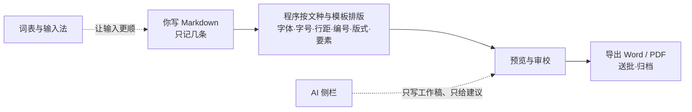

# 使用帮助重构提纲（提案 v3）

> 这份文件只定结构，不写正文。确认后按第八节分期改 `assets/help/`，并同步 `src/help/content.rs` 的文件清单与 `src/help/mod.rs` 的测试。
>
> v3 按你的意见再改：**研究报告不是「长公文」**，而是机关工作中的一种文本，主要提供详细的战略分析与咨询材料；它仍是八文种之一，放第二部分第 7 章，不设附录 E。全书 **21 章 + 4 附录**（连同摘要仍为 26 章，测试计数不用改）。

## 一、一句话

把手册从「功能清单 + AI 说明」改成一条线：**你写 Markdown → 程序按公文规则排版 → 你核稿、出稿、归档**。AI 与词表是加速器，不是发动机。

研究报告是机关工作中的一种文本，主要提供详细的战略分析与咨询材料；它是八文种之一，不是「长公文」，也不是另一套排版。写法、要素、审校、导出与其他公文走同一条链；mdx 只是 Word 导出的历史实现，不构成用户可见的分类。

## 二、现在为什么读起来复杂

| 现象 | 证据 | 后果 |
|---|---|---|
| 入口 AI 优先 | `03-quickstart` 五步是「接模型→测试连接→建标准词库→存模板→出稿」，写 Markdown 只在第 5 步括号里 | 第一次用先被要求配模型，核心写法没登场 |
| 核心写法被埋 | `06-editor` 的「Markdown 要点」在第 113 行左右才出现；`07-ribbon` 167 行按钮表夹在「写」的部分 | 读者先看视图、按钮，才看到「怎么写」 |
| 研究报告被写成「最特殊的一个」 | `08-research` 353 行独立成「专章」，开头就写「八种文种里最特殊的一个」，只被 editor 引 1 次；v1 还打算放附录 E | 读者以为研报要另学一套；其实它是机关工作中的一种文本，主要提供战略分析与咨询材料，是八文种之一；mdx 只是 Word 导出的历史实现 |
| AI 重复且体量大 | `01` 与 `12` 三条红线逐字重复；`12/13/20` 重复「接着跑、提案卡、设置在哪」；AI 相关约 1000 行，占全书近四分之一 | AI 被写成地基，不是加装件 |
| 词表因果倒置 | `15` 标准词库→`16` 校对词表→`17` 公文词表与输入法，真正「打字」的 `17` 排最后；`17` 长 217 行却是全书唯一零引用正文 | 读者要拼三章才知道词表是干什么的 |
| 办文流程不成主线 | `04-workflow` 只有 79 行；状态机在 `19` 又画一遍；版本 `10`、导出 `11`、送批归档 `22` 各自成章，`22` 零引用 | 「立稿→归档」无法顺读 |
| 同一事实多处、数字打架 | `02` 写「七个分区」配八张卡；`02/06` 说「四种视图」，`10` 说「第五个视图」；`09` 说「19 条文档规则+1 条日期核对」，`16` 说「25 条文档级规则」 | 读者不知道信哪个 |

结论：章节顺序是 `f2bc86c` 改研究报告格式时沿用旧手册、之后按功能提交不断追加出来的；不是按「一个从 Word 过来的人怎么写完一篇公文」设计的。

## 三、新主线

图 0-1 手册的主线：排版是主干，AI 与词表是旁路。研究报告只是 B 里的一个文种，按用途是战略分析与咨询材料，不按篇幅定义；mdx 是 Word 导出的历史实现。

读者不需要从头读到尾。扉页给一张「读法」表：

| 你是谁 / 想做什么 | 先读 |
|---|---|
| 第一次用，想先写出第一份 | 第 1–3 章，再第 4–5 章 |
| 从 Word 过来，关心排版 | 第 1、4、6 章 |
| 只关心核稿和出稿 | 第 9–14 章 |
| 要写研究报告 | 第 5、7 章 |
| 想用 AI 打下手 | 第 17–19 章 |
| 想配词表 / 输入法 | 第 15–16 章 |
| 查按钮、快捷键、术语 | 附录 A、B、D |

## 四、新目录（5 部分，21 章，4 附录）

### 第一部分 认识公文助手

1. **一台 Markdown 公文排版软件** `{#chap:intro}`
2. **五分钟出第一份稿子** `{#chap:quickstart}`
3. **界面、视图与标签** `{#chap:ui}`

### 第二部分 用 Markdown 写公文

4. **Markdown 写作法：只记这几条** `{#chap:markdown}`
5. **立稿：文种、要素与默认配置** `{#chap:profiles}`
6. **格式细节：标题、列表、表格、图片** `{#chap:format}`
7. **研究报告：战略分析与咨询材料** `{#chap:research}`
8. **预览、对照与编辑效率** `{#chap:editor}`

### 第三部分 核稿与出稿

9. **办文全流程：从立稿到归档** `{#chap:workflow}`
10. **核稿：审校、校对词表与要素校验** `{#chap:proofread}`
11. **版本、对照与花脸稿** `{#chap:versions}`
12. **导出、打印与文件命名** `{#chap:export}`
13. **送批材料与归档** `{#chap:send-package}`
14. **稿件库：新建、导入与迁移** `{#chap:manuscripts}`

### 第四部分 输入辅助与 AI

15. **词表与输入法：让输入更顺** `{#chap:lexicon}`
16. **标准词库：单位、人员与电话** `{#chap:vocabulary}`
17. **AI 的边界：能做什么、不能做什么** `{#chap:ai-guard}`
18. **AI 侧栏：技能、引用与提案审阅** `{#chap:ai-workbench}`
19. **AI 配置：模型、知识库与数据接口** `{#chap:ai-config}`

### 第五部分 设置与数据

20. **设置全解** `{#chap:settings}`
21. **数据、备份与迁移** `{#chap:data}`

### 附录

- **A 功能区速查** `{#chap:ribbon}`
- **B 快捷键** `{#chap:shortcuts}`
- **C 常见问题** `{#chap:faq}`
- **D 术语表** `{#chap:glossary}`

## 五、逐章要点

### 第一部分 认识公文助手

**第 1 章 一台 Markdown 公文排版软件**（目标 100 行，来源 `01-intro`）
- 只解决：合上这章，读者知道「我写内容，程序管格式」，以及「不配 AI 也能用」。
- 必须讲：一句话定位；Word 手动调格式 vs 这里自动排的 3 组对比（版式、要素、文字规则）；最小 Markdown 示例；AI 与词表是可选辅助（一句，指向第四部分）；适合谁、从 Word 来怎么读；数据在本机（一句）。
- 删/移：删三条红线逐字段与「模型→闸门→用户」理念图；红线移第 17 章；隐私细节移第 21 章。
- 图/截图：新 Mermaid「你写→程序排→成品」；`help-ui-hero.png` 作成品首图。

**第 2 章 五分钟出第一份稿子**（目标 110 行，来源 `03-quickstart`）
- 只解决：零 AI、五分钟走完「新建→写→填要素→预览→导出」。
- 必须讲：五步（不接模型）；一份完整公函的最小 Markdown（标题、主送、正文、落款、日期）；每步看到什么；「第一次打开有示例稿」；卡住时查什么（正文空、要素缺、导出按钮灰）。
- 删/移：接模型与知识库移第 19 章；建标准词库移第 16 章；存模板默认值移第 5 章；只留「选文种」。
- 图/截图：五步路径 Mermaid；复用 `help-ui-hero.png`。

**第 3 章 界面、视图与标签**（目标 90 行，来源 `02-ui`）
- 只解决：知道窗口五区、八个导航页、四个视图 + 版本对照入口、标签与自动保存。
- 必须讲：五区表；导航页表（每页一句话 + 去哪章）；视图怎么选；状态栏；标签与自动保存；主题/字体一句（详见第 20 章）。
- 删/移：主题、纸面、字体细节移第 20 章；功能区按钮表移附录 A；先查代码与 `07`，统一「七个还是八个分区」「四个还是五个视图」。
- 图/截图：`help-ui-elements.png`。

### 第二部分 用 Markdown 写公文

**第 4 章 Markdown 写作法：只记这几条**（目标 220 行，新写，底本 `skills/gongwen-markdown/references/markdown-syntax.md` + `06` 的 Markdown 要点）
- 只解决：记住最小一套写法，能写出与 Word 写作一样的公文正文。
- 必须讲：
  - 为什么用 Markdown：内容与格式分离，一行标题自动变成公文标题。
  - 最小语法表：`#` 标题、`##/###` 小标题、普通段落、`**加粗**`、`-` / `1.` 列表、`|` 表格、`![图]`、`【待核实】`、区段标记。
  - 「Word 里的动作 → 这里怎么写 → 程序排成什么」10 行对照表。
  - 一份完整公函源码 + 成品标注，同一份内容 1:1 对应。
  - 自动编号：不要手打「一、」，程序按标题层级编号；手写编号会被剥离或报告。
  - 十条最容易写错（从语法参考来）。
  - 更多构件见第 6 章；研究报告只是八文种之一，特殊结构见第 7 章，写法不分叉。
- 删/移：不要把第 8 章的视图、粘贴、候选区搬进来。
- 写作要求：这一章是全书核心，必须让读者觉得「只记这几条就够」。

**第 5 章 立稿：文种、要素与默认配置**（目标 150 行，来源 `05-profiles`）
- 只解决：选对文种、把要素填对，新建时自动带出默认值。
- 必须讲：八文种表（适用场景/骨架/默认要素，其中研究报告注明「见第 7 章」）；要素三分区（版头/主体/版记）；密级与保密期限硬规则；行文方向、联合发文、签发人；默认配置（发文单位/编号/字体/版式开关）；要素从哪来（标准词库/模板/手填/AI 建议）；缺要素不挡导出但签发前补齐。
- 删/移：标准词库维护细节移第 16 章；AI 要素建议细节移第 18 章；保留缩略导航一句。
- 图/截图：八文种/要素三分区 Mermaid；`help-ui-elements.png`。

**第 6 章 格式细节：标题、列表、表格、图片**（目标 200 行，来源 `06` 的 Markdown 细节 + `07` 的插入构件）
- 只解决：写到标题编号、表格、图片、附件、引用、待核实、居右时，查这一章就会。
- 必须讲：标题层级与自动编号；段落、空行、首行缩进；行内支持范围；列表两级；表格（合并、序号表、表题、跨页）；图片（独占一行、图题、尺寸、入库）；居中/居右（落款、日期）；附件说明与标记；公文引用《名称》（文号）自动识别与登记簿；`【待核实】`；Mermaid 只给一句「示意图语法见第 7 章」。
- 删/移：按钮步骤移附录 A；视图与粘贴流程移第 8 章；研报专用标记（封面、区段、脚注、引文、公式）移第 7 章；清洗十项放第 8 章。
- 图/截图：表格/图片示例。

**第 7 章 研究报告：战略分析与咨询材料**（目标 280 行，来源 `08-research`）
- 只解决：写研究报告这个文种时，知道它作为战略分析与咨询材料，结构和写法怎么落 Markdown。
- 开头必须写清：**研究报告是机关工作中的一种文本，主要提供详细的战略分析与咨询材料**；它是八文种之一，不是「长公文」，也不是另一套排版；同样的 Markdown、要素、审校、导出链；mdx 只是 Word 导出的历史实现，不在操作上分叉；不写研报可先跳过，不影响后面。
- 必须讲：适用场景（对某一战略问题做系统分析、提出咨询建议、供决策参考，不是通知/请示/一般报告的加长版）；读者与内容要求（问题、背景、分析、方案比选、结论建议）；从文件夹新建四规则；封面 11 字段；七文件类型（项目类/研究类，战略咨询报告、专题研究报告、外文翻译等）；模板与配色；封面样式；区段标记；部分与不编号标题；目录；锚点、交叉引用、脚注、表题；GB/T 7714—2015；引文与文框；Mermaid 五图五样式；图 38%/60%/150DPI；公式 STIX Two Math；`.bib` 只读排序第一份 frontmatter；重复锚点中止导出；目录大写罗马页码；导出与其他文种同入口（Word/PDF），模板细节不同但操作不变；字体。
- 删/移：通用语法与格式移第 4/6 章；导出流程移第 12 章；审校例外移第 10 章；不要把研报写成产品分叉，也不要再设附录 E；不要用「篇幅长/长公文」当定义。
- 图/截图：研报封面/区段 Mermaid；不要新增位图。

**第 8 章 预览、对照与编辑效率**（目标 180 行，来源 `06-editor`）
- 只解决：写的时候看得清、改得快、粘得干净。
- 必须讲：四视图选择 + 版本对照入口；源码编辑器（行号、查找替换、跳转、快捷键）；分栏同步滚动；目录缩略图、标题聚焦；候选区（移入/插回/撤销/按稿存）；粘贴（Word/WPS/网页/Excel → Markdown，`Ctrl+Shift+V` 原样，改为原样粘贴，图片入库）；查找替换；预览导航；自动保存。
- 删/移：主题/字体移第 20 章；版本对照细节移第 11 章；候选区细节可压缩。
- 图/截图：`help-ui-preview-nav.png`。

### 第三部分 核稿与出稿

**第 9 章 办文全流程：从立稿到归档**（目标 80 行，来源 `04-workflow` + `19` 状态机）
- 只解决：知道六步、每步在哪做、状态怎么变。
- 必须讲：六步表（不强制顺序）；每步产出与入口；「核稿还差什么去哪看」六行表；状态机 草稿→发布→归档（归档是唯一终态）；保存 vs 提交版本；缺要素不挡导出、唯一闸门是正文为空。
- 删/移：第 14 章的状态机删掉，只留一句指本章；第 10/11/12/13 章不重复流程细节。
- 图/截图：六步 Mermaid + 状态机 Mermaid（两张）。

**第 10 章 核稿：审校、校对词表与要素校验**（目标 220 行，合并 `09-proofread` + `16-proofread-table`）
- 只解决：知道程序按什么规则挑错、每一级怎么处置、词表怎么维护。
- 必须讲：三档必错/疑似/提示；六组 155 条；文档规则条数**先查代码统一口径**（`09` 的 19+1 与 `16` 的 25 必须只剩一个）；六种命中条件；用户层新增、忽略、记忆、导出 Excel；建议写法三去向（替换/并入公文词表/黑名单）；要素校验六条（含密级年限）；`【待核实】` 闭环；复扫闸门；抽屉交互；哪些文档不套用一般规则（研报、电话记录、附件、引文）。AI 文字复核只留一句指路（第 19 章），不在核稿章展开。
- 删/移：`16` 整章并入；三档、六组、忽略、Excel 只留一份；AI 复核配置细节移第 19 章。
- 图/截图：`help-ui-revision.png`。

**第 11 章 版本、对照与花脸稿**（目标 120 行，来源 `10-versions`）
- 只解决：知道什么时候存、怎么比较两版、花脸稿是什么、怎么回退。
- 必须讲：自动保存与提交版本；版本时间线；对照视图（左改字、右花脸稿，`F7`）；花脸稿颜色与产物；回退不清历史；盖章件归档后是唯一可改的情形；与稿件库版本的关系。
- 删/移：保存、退出、恢复现场与第 14 章重复的删掉，只留一处；「第五个视图」改成「版本对照入口」。
- 图/截图：`help-ui-versions.png`。

**第 12 章 导出、打印与文件命名**（目标 200 行，来源 `11-export`）
- 只解决：把稿子导成 Word/PDF、打印、命名不混。
- 必须讲：导出格式与三个入口；导出前检查（正文空/引用结构/必错/图片/字体）；八文种命名表；函号=机关代字〔年〕序号；待提交规则；输出目录；`-可编辑.md`；四勾选与覆盖策略；打印对话框（打印机、份数、逐份、双面、纸张、纸盒、缩放、预览、手动双面）；打印提示；PDF 查看器；失败原因。
- 删/移：研报导出与其他文种同入口，模板差异只在第 7 章一句带过，不另设附录；批量导出移第 14 章；送批合并移第 13 章；默认勾选与第 20 章去重。
- 图/截图：导出链 Mermaid。

**第 13 章 送批材料与归档**（目标 130 行，来源 `22-send-package`）
- 只解决：把主件和随行件合成一份送批 PDF，并归档钉版。
- 必须讲：主件/随行件/正文附件三分；仅白头与红头呈批件；进包只认提交版本；每件从奇数页起、各件页码不连；任一失败整体不生成；合并预览与记录；归档钉版默认「最近一次导出」；删除保护；随 `.gwx` 同步。
- 删/移：与第 12/14 章重复的导出、归档操作只留一句指路。
- 图/截图：送批合并 Mermaid。

**第 14 章 稿件库：新建、导入与迁移**（目标 180 行，来源 `19-manuscripts`）
- 只解决：在稿件库里找稿、新建、导入、导出包、换机器。
- 必须讲：列表/筛选/搜索；生命周期状态；新建三路（空白/模板/导入）；导入规范化与结构还原（EMF/WMF→PNG）；`.gwx` 包（AES-256、导出/导入/双击/拖放）；批量导出；硬删与孤儿图片；换机器（`.gwx` + 数据目录 + 备份，指第 21 章）。
- 删/移：状态机移第 9 章；保存/退出移第 11 章；导出细节移第 12 章。
- 图/截图：稿件生命周期 Mermaid。

### 第四部分 输入辅助与 AI

**第 15 章 词表与输入法：让输入更顺**（目标 200 行，来源 `17-lexicon`）
- 只解决：把公文里常用词做成自己的词表，打字更快。
- 必须讲：
  - 开头先分清三种「词表」：输入法词表（打字快，本章）、标准词库（要素准，第 16 章）、校对词表（核稿严，第 10 章）。
  - 公文词表扫描→合并→确认→排序→导出五步（内容哈希、只统计发布/归档、单字不入表）。
  - 四码规则（2n-4，二字省 0 不导出）、省键数、重码报告、BOM、涉密明文警告。
  - 导入输入法；基础表、导入表、个人词条；候选与调序；`Ctrl+Shift+A`。
  - 与校对词表联动（建议写法并入、错误写法黑名单）。
  - 日常维护与排障（打不出、重码、不生效），或指 FAQ。
- 删/移：输入法候选窗与按键细节压缩到附录 B 或 FAQ；217 行压到 200 行左右。
- 图/截图：`help-ui-lexicon.png`；三种词表分工 Mermaid。

**第 16 章 标准词库：单位、人员与电话**（目标 150 行，来源 `15-vocabulary`）
- 只解决：单位、人员、电话只维护一次，要素下拉和 AI 建议都准。
- 必须讲：唯一权威、五处使用；单位树十字段（发函/呈批代字/层级）；人员（单位/职务/电话/排序）；主送省略共同前缀；全简称与关系；Excel 三策略（编码优先/不覆盖/增量）；首次建库；备份；与第 15/10 章的喂养关系。
- 删/移：AI 事实闸门细节移第 17 章；校对词表细节移第 10 章。
- 图/截图：标准词库结构 Mermaid。

**第 17 章 AI 的边界：能做什么、不能做什么**（目标 110 行，来源 `12-ai-guard`）
- 只解决：知道 AI 能碰什么、不能碰什么、出了事谁兜底。
- 必须讲：三条红线（全书只此一份，第 1 章不再重复）；能做什么/不能做什么表；工作稿 vs 正式稿；事实闸门五类（单位/人员/日期/数字/文件依据）；来源标注；确认三档；采纳后自检与回滚；修订建议五字段；大小模型；用量、追溯、断点续跑；不配 AI 也能完整走完写、核、发。
- 删/移：第 1 章的红线段删；第 18 章的「接着跑/提案卡」细节移第 18 章；第 10 章的自检细节移第 10 或 19 章。
- 图/截图：三道闸门 Mermaid。

**第 18 章 AI 侧栏：技能、引用与提案审阅**（目标 280 行，来源 `13-ai-workbench`）
- 只解决：会用侧栏发起起草/修改/审核，会看提案并逐块接受。
- 必须讲：侧栏布局、入口、会话；`/` 技能、`@` 引用四用法（证据/基准稿/材料/来函）；内置技能表（起草/修改/审核三类，数量以实际为准）；先查后写六步；要素选择题与待核实问答；提案审阅（工作稿/正式稿、逐块接受/排除、对照、修订建议）；采纳后自检；20 会话/100 轮；用量、历史、断点续跑；三个典型用法（起草公函、改一段、审一遍）。
- 删/移：模型地址/密钥/知识库配置移第 19 章；技能安装与自定义移第 19 章；红线移第 17 章。
- 图/截图：侧栏/提案流 Mermaid。

**第 19 章 AI 配置：模型、知识库与数据接口**（目标 260 行，合并 `14-ai-polish` + `18-knowledge`）
- 只解决：配好模型服务、知识库、技能与数据接口，知道边界和排障。
- 必须讲：AI 管理页总览；模型服务商（预设/卡片/地址密钥/迁移）；按功能选模型（起草/复核/知识库）；测试连接；文字复核（小模型温度 0）；知识库（来源/索引/检索测试/问答/RAG 三步降级/换 embedding 重建/预览）；技能管理（SKILL.md、安装位置、调试台）；数据接口（OpenAPI/用例/AI 调用/两级访问/密钥不随导出）；风格、润色预设、输出标准；用量、日志、隐私。
- 删/移：`18` 整章并入；`14` 的模型与接口保留但压缩；与第 20/21 章重复的搬迁提示删。
- 图/截图：RAG/模型配置 Mermaid。

### 第五部分 设置与数据

**第 20 章 设置全解**（目标 200 行，来源 `20-settings`）
- 只解决：知道哪些设置值得改、改了影响什么。
- 必须讲：十一分区表（每项一句话、默认值、去哪章）；代理（不认 PAC、`socks5h`、本机直连）；输出目录；字体四层、`.ttc` 不可选、GBK 兜底；自动保存 30–600 秒；密级上限；主题/纸面；输入法设置（指第 15 章）；上手指引；「必须改/不用动」清单。
- 删/移：与第 3 章重复的主题、字体细节只留一处；AI 搬迁提示删。
- 图/截图：设置分区表。

**第 21 章 数据、备份与迁移**（目标 170 行，来源 `21-data`）
- 只解决：知道数据在哪、怎么备份、换机器怎么搬。
- 必须讲：三平台配置目录；`config/` 清单；备份不含 `logs/`；应用内备份/恢复四步；换机 7 步；隐私（本地、密钥、请求内容）；清理；故障恢复与崩溃日志。
- 删/移：与第 14 章的 `.gwx` 迁移去重；与第 19 章的密钥去重。
- 图/截图：数据目录树 Mermaid。

### 附录

- **A 功能区速查**（160 行，来源 `07-ribbon`）：八分区按钮表与快捷键提示；「找不到按钮查这里」；插入构件、公文引用、清洗只留链接（正文在第 6/8 章）。
- **B 快捷键**（70 行，来源 `a-shortcuts`）：补新键，按场景分组。
- **C 常见问题**（150 行，来源 `b-faq`）：按用户任务重排，能指路就不复述。
- **D 术语表**（150 行，来源 `c-glossary`）：按新结构补「工作稿/提案/闸门/四码/省键数」等。

## 六、关键取舍

| 决定 | 选择 | 理由 | 备选 |
|---|---|---|---|
| 研究报告放哪 | **第二部分第 7 章（八文种之一）** | 它是机关工作中的一种文本，主要提供详细的战略分析与咨询材料；mdx 只是 Word 导出的历史实现；放附录 E 会把它写成另一类文档。放在立稿、格式之后，是因为它的封面、区段、引用、公式等结构比一般公文多，先学通用写法再学它 | 并进第 5 章（会撑大立稿章，280 行压过要素） |
| 标准词库放哪 | **第四部分第 16 章** | 它是要素候选与 AI 建议的数据源，属于「辅助」；第 5 章只给入口 | 并进第 5 章（会撑大立稿章） |
| 校对词表放哪 | **第 10 章核稿** | 它不是输入辅助，是核稿的裁判；三种词表分工在第 15 章开头讲清 | 并进第四部分（会混淆「词表都能让输入更顺」） |
| 功能区放哪 | **附录 A** | 按钮表是参考，不是叙事；插入构件留在第 6/8 章 | 留在正文（继续打断写作线） |
| AI 放哪 | **第四部分 17–19 章** | 前面只留一句「可选」；不配 AI 也能走完写、核、发 | 保留第三部分「AI 能力」（仍是前置） |
| 部分数 | **5 个** | 与现有测试 `parts == 5` 一致；21 章 + 4 附录 + 摘要 = 26，测试章数也不用改 | 6 个部分（多一层，增加复杂感） |

### 锚点与测试

- 保留旧锚点：`chap:intro`、`chap:quickstart`、`chap:ui`、`chap:profiles`、`chap:editor`、`chap:workflow`、`chap:proofread`、`chap:versions`、`chap:export`、`chap:send-package`、`chap:manuscripts`、`chap:lexicon`、`chap:vocabulary`、`chap:ai-guard`、`chap:ai-workbench`、`chap:settings`、`chap:data`、`chap:ribbon`、`chap:shortcuts`、`chap:faq`、`chap:glossary`、`chap:research`。
- 新增：`chap:markdown`、`chap:format`、`chap:ai-config`。
- 锚点新家：`chap:research` 在第二部分第 7 章；`chap:proofread-table` 挂第 10 章「校对词表」小节；`chap:ai-polish`、`chap:knowledge` 挂第 19 章对应小节。这样 75 处 `{@chap:…}` 大多不用改。
- `QUICKSTART_CHAPTER = "chap:quickstart"` 与标题「五分钟出第一份稿子」保持不变。
- `help_page_snapshot` 用的 `fig:demo-flow` 锚点保留在某张 Mermaid 图上。
- 六张截图必须都还被引用；Mermaid 至少 10 张；正文文件清单与 `FILES` 一致。
- 计数：5 个部分、26 章（摘要 + 21 章 + 4 附录）、`附录A` 存在。研究报告不再有附录 E。

### 必须统一的硬事实

- 功能区到底是七个还是八个分区（`02` vs `07`）。
- 起草页是四个视图还是「四个 + 版本对照入口」（`02/06` vs `10`）。
- 文档规则条数：`09` 的「19+1」与 `16` 的「25」以代码/词表实际为准。
- 内置技能数量（盘点为 15，AGENTS.md 旧文写 12）：以 `assets/agent-skills/` 与代码为准。
- 研究报告：封面 11 字段、七文件类型、GB/T 7714—2015、图 38%/60%/150DPI、Mermaid 五图五样式、公式 STIX Two Math、`.bib` 只读排序第一份 frontmatter、重复锚点中止导出、目录大写罗马页码。
- 以上数字在动笔前先核实，写进「单一事实源」表，后面只引用。

## 七、写作纪律

1. 每章开头一句话「这一章只解决一件事」，结尾一句「接下来读第 X 章」。
2. 先给「最小可用」，再给「完整参考」；纯按钮、纯快捷键、纯术语一律进附录。
3. 每个语法点都要有「写出来是什么」：对照表、截图或成品标注。
4. 每章至少一个「你不需要……」框：不用调字体、不用手打编号、不用自己排版。
5. AI 章统一口径：先说「不配也能用」，再说「它只写工作稿 / 只给建议」，最后说边界。
6. 词表章统一口径：先分清三种词表，再讲本章那一种；输入法排在最前。
7. 同一事实只在一章详写，其余章只给一句指路；数字必须与代码/词表核对。
8. 语言用第二人称、短句；内部词（工作稿、提案、闸门）第一次出现就解释。
9. 研究报告章开头先声明「机关工作中的一种文本、八文种之一，主要提供战略分析与咨询材料」；禁止写「另一类文档 / 另一套排版 / 长公文」；mdx 只在实现说明里一句带过，不作为用户操作分类。

## 八、执行计划

**第 0 步 提纲确认**（本文件）
- 只改目录与章节职责，不动正文。

**第 1 步 结构落位**（Lead，一次提交）
- 用 `git mv` 重命名文件：`03→02-quickstart`、`02→03-ui`、`06` 拆成 `04-markdown` 与 `08-editor`、`08→07-research`、`04→09-workflow`、`09+16→10-proofread`、`10→11-versions`、`11→12-export`、`22→13-send-package`、`19→14-manuscripts`、`17→15-lexicon`、`15→16-vocabulary`、`12→17-ai-guard`、`13→18-ai-workbench`、`14+18→19-ai-config`、`20` 与 `21` 不动、`07→a-ribbon`、`a→b`、`b→c`、`c→d`。
- 拆分细节：`06` 的 Markdown 要点与语法进 `04-markdown`，视图/编辑/粘贴/候选区进 `08-editor`；`07` 的插入构件进 `06-format`，纯按钮表进 `a-ribbon`。
- 更新 `src/help/content.rs` 的 `FILES`；改 `00-front` 摘要与读法；改跨章引用；给旧锚点找新家；更新 `src/help/mod.rs` 的注释与必要的计数。
- 此时正文仍是旧文字，只保证 `cargo test --locked help::` 全绿。

**第 2 步 核心叙事**（Lead + 1 位 teammate）
- 重写 `00-front`、`01-intro`、`02-quickstart`、`03-ui`、`04-markdown`、`05-profiles`、`06-format`、`07-research`、`08-editor`。
- 这是「规范、简单」的第一印象，必须由同一支笔写；第 7 章由 Lead 写，确保「八文种之一、战略分析与咨询材料」的口径。

**第 3 步 办文线**（1 位 teammate）
- 重写 `09-workflow` 到 `14-manuscripts`。

**第 4 步 辅助线**（1 位 teammate）
- 重写 `15-lexicon` 到 `21-data`，以及 `a-ribbon` 到 `d-glossary`。

**第 5 步 集成与验收**（Lead）
- 通读去重、统一数字、补图、检查截图、出 PDF 样张目视。

写作用文件范围互不重叠：Lead 管 `00`、`01–04`、`07`、`content.rs`、`mod.rs`；teammate A 管 `05`、`06`、`08`；teammate B 管 `09–14`；teammate C 管 `15–21` 与附录。第 1 步由 Lead 先做完，再并行。

## 九、验收清单

- `cargo test --locked help::` 全绿。
- `cargo test --locked help_pdf_sample -- --ignored --nocapture` 出 PDF，目视封面、目录、每部分首页、图、表、代码块。
- `cargo test --locked help_page_snapshot -- --ignored --nocapture` 出 PNG，目视图与目录。
- 五个部分、26 章（摘要 + 21 章 + 4 附录）、`附录A` 存在。
- `chap:quickstart` 存在且标题含「五分钟出第一份稿子」。
- 75 处交叉引用全部有锚点；六张截图全部被引用；Mermaid ≥ 10 张。
- 人工走四条路：零 AI 五分钟、从 Word 迁、AI 起草、写研究报告；每条路不看别的章也能走通。
- 研究报告在第 5 章有文种入口、第 7 章有专章，附录里没有「研报另属一类」的痕迹；第 7 章按用途定义，不写「长公文」。

## 十、待你确认

1. **研究报告放第二部分第 7 章**（格式细节之后、编辑效率之前），作为八文种之一的「战略分析与咨询材料」；不再设附录 E。这个位置是否顺手？
2. **标准词库放第四部分第 16 章**、第 5 章只给入口，是否同意？
3. **21 章 + 4 附录**这个规模是否合适？要不要再把「版本」并进第 14 章稿件库、「送批」并进第 12 章导出，压到 19 章？压了之后测试章数要改，但读起来更短。

确认后我先做第 1 步结构落位，把骨架和测试跑通，再按第 2–4 步分头写正文。
