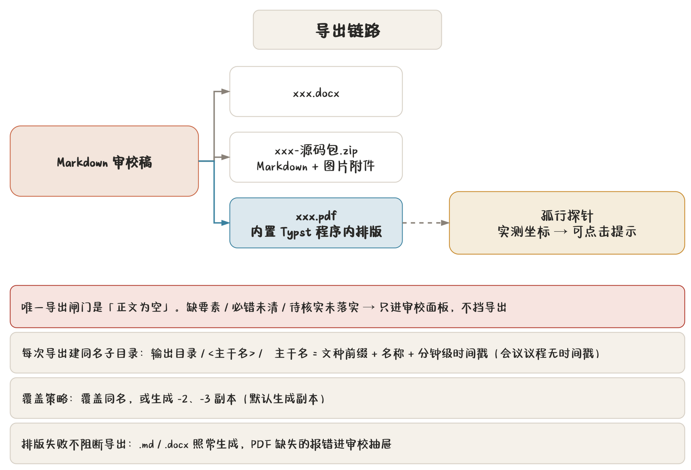

## 导出在哪、怎么导

入口有两处：

- 功能区「输出」分区（最全，含格式勾选）；
- 标题栏快捷访问的「导出」按钮（用上次的勾选）。

导出链路一图流：



程序做的事：

1. 生成 Markdown / DOCX（按勾选）；
2. 勾了 PDF 就排 PDF：内置 **Typst** 引擎在程序里直接排版，一份公文几十毫秒，完全离线，不依赖本机装任何排版软件；研究报告用它自己的版式模板，同样在程序里排；
3. 排完版回读**孤行探针**实测坐标，生成带正文位置的可点击提示；
4. 排版失败**不阻断导出**——PDF 缺失记「排版错误」，在审校抽屉用红色提示框显示，其余产物照常可用。

## 四个勾选与覆盖策略

| 勾选 | 产物 |
|---|---|
| Markdown | `.md` 源码 |
| Word | `.docx` |
| PDF | `.pdf` |
| Typst 包 | `-Typst包.zip`：模板、数据与插图，装有常见中文字体的机器可用 Typst 命令行编译 |

前三种默认全勾，Typst 包默认不勾。

> **提示** 只要 Word 不要 PDF？取消 PDF 勾选即可。反过来，公文的 PDF 由排版引擎按公文版式直接排出，不能从 Word 转——版式一致性就靠这条链路保证。

Typst 包是给「机器上装了 Typst」的场合准备的：包里不含字体，解压后在包目录执行
`typst compile gongwen.typ`（研究报告为 `research.typ`）即可出 PDF。所需字体清单与
与 App 内 PDF 的差异写在包内 `README.txt`；本机没有这些字体时，可用 `--font-path`
指向任意含字体的目录。

**覆盖策略**二选一：

- **覆盖同名**：同名文件直接盖掉；
- **生成副本**（默认）：同名时加 `-2`、`-3` 后缀，一次都不丢。

## 文件命名规则

每次导出在输出目录下建一个**同名子目录**，主干名按文种起：

| 文种 | 主干名格式 | 例 |
|---|---|---|
| 公函 | `{函号}-名称-版本名称` | `办函〔2026〕12号-关于商洽的函-送审稿` |
| 电话记录单 | `电话记录单-版本名称` | `电话记录单-初稿` |
| 电话通知 | `电话通知-版本名称` | `电话通知-送审稿` |
| 普通公文 | `普通公文-名称-版本名称` | `普通公文-关于X的通知-送审稿` |
| 会议议程 | `名称-会议时间-版本名称` | `办公会-3月20日上午9时-送审稿` |
| 白头件 | `白头-名称-版本名称` | `白头-关于X的请示-送审稿` |
| 红头呈批件 | `红头呈批-{函号}-名称-版本名称` | `红头呈批-办函〔2026〕12号-X-送审稿` |
| 研究报告 | `研究报告-名称-版本名称` | `研究报告-X课题-送审稿` |

- **后缀使用实际对应的提交版本名称**，如“送审稿”“定稿”；尚未入库、从未提交或提交后正文 / 行文要素有修改，都用“待提交”。保存到稿件库不等于提交版本；
- 函号 = 机关代字〔年〕序号号；无序号回落用机关代字；全缺用「公函」；
- 载入历史版本且未修改时，用该历史版本的名称；所有文种（含会议议程）统一使用版本后缀；
- 重复导出同一版本或“待提交”稿时，按覆盖策略复用目录或追加 `-2`、`-3`，目录与内部文件共用主干名；
- 文件名与版本名称经净化，非法字符替换掉，过长名称截短。

## 输出目录结构

```text
输出目录/
  办函〔2026〕12号-关于商洽的函-送审稿/
    办函〔2026〕12号-关于商洽的函-送审稿.docx
    办函〔2026〕12号-关于商洽的函-送审稿.pdf
    办函〔2026〕12号-关于商洽的函-送审稿-源码包.zip
    办函〔2026〕12号-关于商洽的函-送审稿-Typst包.zip
```

输出目录在「设置 → 输出与录入」里选，默认是**当前工作目录**。设置页可直接打开该目录。

源码包 `.zip` 里是 Markdown 正文与它引用的图片（研究报告另带 frontmatter 与 `references.bib`），拿到别的机器导入公文助手就能复现。

有公文引用时，主 `.md` 已展开成《名称》（文号），供普通 Markdown 工具使用；
包内另带 `-可编辑.md`，保存引用标记和快照。需要继续管理引用时导入可编辑文件，
或直接用稿件库的离线 ZIP 同步。Word / PDF 都使用本篇快照，不要求本机存在来源稿件。

## 成品三入口

「输出」分区的三个图标是 PDF / WORD / Typst 包成品入口：

- 按本次主干名前缀在输出目录里找**最近一次**产出；
- 找到就点亮，点了直接用系统程序打开；
- 找不到（这次还没导过）就灰着，点了提示先导出。

导出成功后，状态栏显示实际输出子目录。Typst 包入口可直接打开 ZIP，右键可另存或在文件管理器中定位；「输出目录」打开设置中的输出根目录。

## 研究报告的导出

研究报告的产物更多，见 [研究报告专章](chapter:08-research)。要点：

- PDF 是一个文件：封面、目录、正文、附录与参考文献都在里面；
- 勾选 Word 时走研究报告自己的 mdx 转换器，封面、目录与分节页码与 PDF 对齐；
- 数学公式与预览用同一个排版器，预览看到的公式就是 PDF 上的公式。

## 批量导出 PDF

稿件管理页勾选多篇 → 「导出 PDF」：

- 后台逐篇排版，不卡界面；
- 盖章扫描件自动以「（盖章）」命名；
- 全部产物打包成一个 ZIP 下载到你选的位置。

适合换季归档时一次性出一批 PDF。

## 打印

PDF 查看器里点「打印」（或按 Ctrl+P，macOS 为 ⌘P）弹出程序自己的打印对话框，
Windows、macOS、麒麟上长得一样：

- **打印机**：列出本机与网络打印机，标出系统默认的那台，名字后面是状态
  （就绪 / 正在打印 / 已暂停 / 脱机 / 缺纸之类）。默认选上次用过的那台；
  状态只作提醒，脱机的打印机也能把任务排进队列；
- **份数**与**逐份打印**：逐份是一份打完再打下一份，不勾则每页连打几张。
  打印机份数只是把同一份重复打出，**份号不同的多份要在导出时生成**；
- **页码**：全部、当前页，或自定义（如 `1-3,5`，中文逗号、顿号、全角数字也认；
  `8-` 表示第 8 页到末页）。底部一行算出大概要几张纸（双面按每份
  `ceil(页数 / 2)` 张算）；
- **双面**：单面、长边翻转、短边翻转、手动双面（翻面再打），或「打印机默认」。
  没有双面单元的打印机不显示长边 / 短边，但仍可选「手动双面」；
- **颜色**：彩色、黑白，或「打印机默认」。单色机固定显示「黑白」并置灰；
- **纸张**与**纸盒**：第一项是「打印机默认（A4）」与「自动选择」，其后是这台
  打印机支持的纸型与纸盒，纸盒列表为空时置灰；
- **缩放**：「实际大小（公文推荐）」按纸张实际大小出图，放不下时自动缩小；
  「适合纸张」按可打印区等比缩放，纸型与版面不一致的外来 PDF 用它；
- **公文提醒**：按双面排了页码却选单面、送批材料选单面、整份横排选长边、版面
  有红色却打黑白、所选纸张不是 A4 却用实际大小，都会在底部出现黄色提醒。
  只是提醒，不拦打印；
- **打印机首选项…**（仅 Windows）：打开驱动自己的设置窗口，可设装订、打孔、
  水印等驱动独有的选项。设过之后双面、颜色、纸张、纸盒四行置灰、以首选项为准，
  旁边「恢复」可以清掉；换打印机时自动清掉；
- **页面预览**：对话框左边按所选纸张的比例画出纸页，显示当前预览页；下面
  「◀ 3 / 12 ▶」在**要打的页**里翻（双面时纸角标「正面 / 反面」）。还没渲染
  过的页显示占位，回到 PDF 滚动到该页再打开对话框即可见；
- **打印中**：对话框不关，显示「正在送第 3 / 12 页…」（CUPS 显示「正在交给
  打印服务…」）、「取消」和「转到后台」；打完自动关闭，结果在状态栏回报（CUPS
  会带任务号，如「任务 HP_Deskjet-12」）。页数多、不想等，点「转到后台」关掉窗口
  接着干活；点了取消但驱动迟迟不响应时，可以点「关闭窗口」不再等待；
- 回车即打印，Esc 取消（打印进行中只认按钮）。

起草页功能区「输出」分区里也有一个「打印…」直达入口：先按导出设置里的**覆盖策略**
只导出一份 PDF，排好后自动在应用内打开并弹出同一个打印对话框，不用先导出、再切到
PDF 标签去点打印。排版失败或没导出 PDF 时不会打开对话框，状态栏会说明「PDF 没有
排出来，无法打印」；本机没有打印服务时这个按钮置灰。

打开按双面排了页码的稿件、或送批材料合并件时，双面默认长边；整份横排的 PDF
默认短边翻转（装订边才对得上）。这些默认值只填你还没动过的选项。打印机没有
双面单元时，对话框会提醒「会打成单面」，可改选「手动双面」。

双面、颜色、纸张、纸盒与缩放的**每台打印机偏好**都记着：切回这台打印机时自动
预填上次的选择，点「打印」时再写回配置。手动双面没有双面单元也能用：先打正面，
按提示把整叠纸翻面放回纸盒，再点「继续打印反面」；页数为奇数时会提示把最后一张
先取出。翻面方向因机器而异，第一次建议先拿两三页试一下，「反面倒序出纸」按打印机
记住。

Windows 上程序按纸张**实际大小**出图，公文版心与页边距按毫米打准；横向附件按竖纸
方向打出，不再缩小。对话框左下角的「使用系统对话框…」改用 Windows 自带的打印
对话框。macOS 与麒麟交给系统的 CUPS 打印服务出纸，双面、颜色、纸张、纸盒、缩放
按上面的选项作为 `lp` 参数交给 CUPS。

双面打印的页码位置在要素表单「双面页码」开关里配。

## PDF 查看器

导出的成品与归档的盖章扫描件都在标签页里用**内置查看器**打开——纯 Rust 渲染，不依赖系统 PDF 阅读器。工具栏：

| 控件 | 说明 |
|---|---|
| 页码框 | 直接跳到第 N 页（右边写总页数） |
| **连续** | 默认。所有页上下相连，自由滚动 |
| **单页** | 按页翻看，滚轮一格翻一屏；**窗口够宽时从左到右并排多页**（最多 6 页）。也可用 `PageUp` / `PageDown`、方向键翻页 |
| 缩放 | `−` / `+`、百分比、`100%`、`适合宽度`、`适合页面`；按住 `Ctrl` 滚动滚轮同样缩放 |
| 打印 | 见上一节 |
| 系统打开 | 复杂或加密的外来 PDF 走系统程序兜底；「在文件管理器中定位」直接指到文件 |

打开时先取全部页面的点尺寸，滚动条一开始就是准的；只有视口内的页才光栅化，一页要一两秒的重页由几条渲染线程分担，不堵住后面的轻页。

**选字与复制**：鼠标移到文字上会变成文本光标，按住拖动即可选字，跨行跨页都行；拖出视口会自动滚动。`Shift` 加选，`⌘C` / `Ctrl+C` 或右键「复制」取走选中的文字，`Esc` 或单击取消。复制出的文字里西文词间按间隙补回空格，中文之间不补。

## 导出前检查

> **注意** **正文为空**或**公文引用结构损坏**会挡导出。引用未定义、重复定义、快照损坏或标记破损时，请先修复，避免正式成品印出错误标记。其他要素缺失、必错未清、待核实未落实，仍会进审校面板，通常不挡导出。

这个设计是刻意的：赶时间时先出个格式对的稿子补文号是真实节奏。导出成功后状态栏末尾会缀上「仍有 N 项要素问题待补齐」，左栏要素区的「缺 N 项」也一样。**把审校面板当待办清单用，别当路障。**

## 导出后 PDF 排版失败怎么办

排版失败不回滚导出：

1. `.md` / `.docx` 照常生成；
2. 审校抽屉出现红色提示框，写明排版错误；
3. 修好后重新导出（用覆盖策略管住文件数）。

常见原因：本机字体被删、研究报告的随包字体缺失（runtime 不完整）、图片路径失效。研究报告公式写错不会让 PDF 失败，排不出的公式按源码印出并在提示里列出。排查见 [附录 B 常见问题](chapter:b-faq)。
