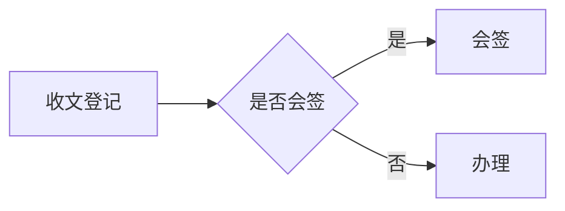

# 公文助手 Markdown 语法完整参考

公文助手认的不是网页 Markdown，而是一套「公文子集」。下面每一条都写明**程序会怎么处理**：
要么「这样写会被识别」，要么「这样写会按普通文字印出来」。没列出来的语法一律按后者处理。

文种差异见 [document-types.md](document-types.md)；研究报告的额外语法见
[research-report.md](research-report.md)。

## 0. 最小骨架

```markdown
# 关于××工作的函

<!-- [正文] -->

第一段正文。

## 一级标题

正文。

<!-- [附件] -->

# 情况统计表

附件内容。
```

- 只写正文。版头、密级、文号、主送、落款、成文日期、抄送、版记、页码、字体字号、
  标题编号、附件编号全部由程序生成。
- 行首不要手打空格（程序自动首行缩进）；标题不要手写编号；不要手写「附件：1.…」说明。

---

## 1. 文档标题与区段标记

### 1.1 文档标题

| 写法 | 程序处理 |
|---|---|
| 单独一行 `# 标题` | 认成文档标题：方正小标宋二号居中。取全篇**第一个** `# ` 行 |
| 正文区再写一个 `# 标题` | 不排（内容消失），校验提示「正文区检测到多个一级标题」 |
| `#` 后没有空格（`#标题`） | 不认成标题，按正文印出（`#` 也印出来） |
| 空标题（只有 `#`） | 当正文印出 `#` |

- **标题写第一行，正文区只写一个。** 写在标题前面的正文会被程序挪到标题后面（顺序会变），
  自检脚本也按错误报出。
- 标题要长也不要手工换行，程序按公文回行规则自动断行。
- 标题末尾不加句号（自检脚本提示「标题末尾一般不加句号」）。

### 1.2 区段标记

标记**必须独占一行**：行首行尾的空格无所谓，但这一行不能有别的内容。

| 写法 | 程序处理 |
|---|---|
| `<!-- [正文] -->` | 从这里切回正文区 |
| `<!-- [附件] -->` | 从这里开始一份新附件 |
| `<!-- [附录] -->` | 同 `[附件]` |
| `<!--附件-->`（无空格） | 同上 |
| `<!-- 【附件】 -->` | 同上 |
| `<!-- [attachment] -->`、`attachments`、`appendix` | 同上（英文不分大小写） |
| `<!-- [body] -->`、`<!-- 【正文】 -->`、`<!-- 正文 -->` | 正文区 |
| `<!-- [摘要] -->` 等其它名字 | 整行丢掉，不印、也不产生任何版式（等于注释） |
| `<!-- [附件] --> 后面还有字` | 不认；整行按正文印出 |
| `<!--` 与下一行的 `-->` 分两行写 | 不认；两行都按正文印出（注释必须一行写完） |

- 标记行本身不印到纸上。
- **每个附件标记开始一份新附件：另起一页，标题编号从「一、」重新数。**
  正文标记可写可不写；写了只是切区段，不会多出任何文字。
- 一个附件标记之后紧跟的第一个 `# ` 标题就是这份附件的**正式标题**，它同时决定正文之后
  附件说明里的名字。附件内部用 `##`、`###` 表示「一、」「（一）」，从 1 重新编号。
- 附件说明由程序生成：只有一份附件时印「附件」，多份时印「附件1」「附件2」。
  所以标题里不要写「附件1」——写成附件本身的名字（如 `# 情况统计表`）。
- 不要手写「附件：1.××」这类说明行；有附件区段时校验会报错。
- 附件标记之后不写 `# 标题`：校验提示「每个附件标记之后应使用“# 附件正式标题”」。
  标记之后没有任何内容：校验提示「检测到没有内容的附件标记」。
- 历史写法 `# 附件1` + 下一行 `## 附件正式标题` 程序也能读（内部会折算层级），新稿不要用。
  `# 附件1：统计表` 这种把名字写在同行也认。

## 2. 标题层级与自动编号

| 写法 | 默认编号 | 字体 |
|---|---|---|
| `# 标题` | 不编号（文档标题 / 附件标题） | 方正小标宋二号居中 |
| `## 标题` | 一、 | 黑体 |
| `### 标题` | （一） | 楷体 |
| `#### 标题` | 1. | 仿宋加粗 |
| `##### 标题` | (1) | 仿宋加粗 |
| `###### 标题` | 不编号 | 不排（公函等正文版式里整条消失） |

- 编号样式由用户在「设置 → 标题与列表编号」里按级配置（可改成「第一章」「第一部分」
  等），所以**永远不要手写编号**。手写的编号大多数会被剥掉、不影响成稿，但自检脚本
  一律按 ERROR 计，所以直接不写。
- 只按 `#` 的个数定层级。不要跳级：`##` 下面直接写 `####` 会排出「一、」后直接「1.」。
- 最多写到 `#####`。`######` 不编号，而且在公函 / 电话通知 / 普通公文 / 白头件 /
  红头呈批件这类正文版式里整条不排（内容消失）。
- 标题独占一行。`##` 后必须有空格，`##标题`、空的 `##` 都会被当正文印出来。
- 标题下面空一行是默认写法；空不空行只在选了「紧缩」排版风格时才有区别（见下）。

### 2.1 手写编号剥离前缀全集

程序只对 `##`~`#####` 的标题做剥离（`#` 标题不剥），序号表分组行首格用同一套规则。
下表「剥」= 前缀被删掉、程序重新编号；「不剥」= 前缀和标题一起印出来。

| 标题开头 | 结果 |
|---|---|
| `一、` `一，` `一.` `一．` | 剥 |
| `（一）` `(一)` | 剥（标点后不必有空格） |
| `（1）` `(1)` | 剥（标点后不必有空格） |
| `1.` `1．` `1、` | 剥，**点号 / 顿号后必须有空格** |
| `1 `（数字 + 空格） | 剥 |
| `1.1` `1.2.3` | 剥（后面不必有空格） |
| `第一章` `第二节` `第三条` `第三部分` | 剥（后面不必有标点） |
| `附录A` `附录 A.1` `Appendix A`（英文不分大小写） | 剥 |
| `1.标题` `1、标题` | **不剥**，会印出「1.标题」这样带两个号的效果 |
| `1)标题` `1）标题` `+ 标题` | 不剥 |

- 能识别的前缀会被逐条剥掉；剥不掉的（比如手写的 `1.标题`）会和程序编号叠在一起。
- 标题以「数字 + 空格」开头也会被剥，四位年份也不例外：`### 2026 年第三季度数据`
  会印成「年第三季度数据」。**标题里数字与汉字之间不要留空格**，写 `2026年第三季度数据`；
  正文里同样建议不留空格。
- 标题正文本身以带标点的序号开头时也会被剥（如 `一、以…` 变成「以…」），换个说法避开。
- 正例：`## 工作安排` → 印「一、工作安排」。
  反例：`## 一、工作安排` → 程序先剥「一、」，仍然印「一、工作安排」（写法没坏，但没必要）；
  `## 1.工作安排` → 印「一、1.工作安排」（剥不掉，出现两个号）。

### 2.2 标题与正文接排（紧缩风格）

用户在「文档要素 → 排版风格」里可能选「全局紧缩」或「节内紧缩」。此时：

- 被选中的那一级标题**紧贴下一行正文写、中间不空行**，程序把两者接成一段，
  标题后自动补句号：「1.要素核对。本单位……」；空了一行就照常单独成段。
- 全局紧缩只选正文区里最深的那一级标题；节内紧缩以每个 `##` 为一节，各选本节最深一级。
- 只对**正文区**生效，附件区不紧缩；下一块不是正文段落（是列表、表格、图片、标题）时也不接排。
- 没选紧缩时，空不空行都一样，标题照常单独成段。

```markdown
#### 要素核对
本单位……        ← 紧缩模式下接排：“1.要素核对。本单位……”

#### 流程说明

本流程……        ← 空了一行，标题单独成段
```

## 3. 段落

- 段与段之间空一行。
- 连续的非空行会接成**同一个自然段**：中文之间不插空格；西文 / 数字接缝会自动补一个空格。
  一段话折成几行写也行。
- 每行行首行尾的空白都会被去掉（包括手打的和全角空格）；不要在行首打空格。
- 每段自动首行缩进两字、两端对齐。
- 连续多个空行等同于一个空行，不要用空行做「视觉间隔」。
- 段里不要出现 `<div` 或 `</div`：**整段会被程序丢掉**。

正例：两行「为做好……工作，」「现将有关事项通知如下。」→ 接成一个自然段。
反例：一句话中间空一行 → 断成两段，后一段自己缩进、语气也断了。

## 4. 行内格式（加粗、括号楷体、转义）

| 写法 | 程序处理 |
|---|---|
| `**文字**` 或 `__文字__` | 着重（按用户设置排黑体或加粗）。必须成对，不成对时按字面印出 |
| `（说明）` `(API)` `【注】` | 成对括号内的文字整体排楷体，不需要任何标记 |
| 反引号 `` `文字` `` | 反引号被丢掉，里面的字按正文排（不是等宽代码） |
| `*斜体*`、`~~删除~~`、`==高亮==` | 不识别，符号照印 |

- 加粗不要跨段（跨段不成立），一段里最多一两处。
- 括号必须配对：`（`配`）`、`(`配`)`、`【`配`】`。嵌套时整个外层括号段都排楷体；
  落单或不配对的括号按普通文字排。表格单元格里同样适用。
- 转义：反斜杠 + **半角标点**只印后面那个标点，例如 `\*`、`\_`、`\#`、`\>`、`\|`。
  反斜杠后面是汉字或字母时，反斜杠也照印。
- 引号一律用中文全角 “”‘’；写成半角 `"` `'` 程序会自动改成全角，
  「」『』也会被改成 “”‘’。书名号《》，省略号……，破折号——。
- 数字与单位用阿拉伯数字。

正例：`请于（2026年8月20日）前报送` → 括号部分排楷体。
反例：`请于（2026年8月20日前报送` → 括号不配对，全部按正文排。

## 5. 列表

### 5.1 只认这三种写法

只有下面三种行首写法会被认成列表项：

```markdown
1. 内容      ← 半角点 + 空格，数字 1–9 位
- 内容       ← 半角横线 + 空格
* 内容       ← 半角星号 + 空格
```

下面这些**都不认**，整行按正文印出：
`1、内容`、`1) 内容`、`（1）内容`、`①内容`、`+ 内容`、`-内容`、`1.内容`（点后缺空格）。

### 5.2 编号与分段

- 有序 / 无序**效果相同**：`1. 内容` 与 `- 内容` 一律按程序设置编号，源码可以混写。
- 独立成段时用「独立列表」编号，默认 `1. 2. 3.`；并入段落时用「段内列表」编号，
  默认 `①②③`。两类样式都能在设置里改。
- 决定分不分段的是**上一非空行**：
  - 上一非空行是一行正文（中间没有空行）→ 各项并入上一段，接成「……有以下几项：①甲；②乙。」
  - 上一非空行是空行、标题、表格、图片，或列表在文件开头 → 每项独立成段。
- 组内编号：整组从**第一项写的数字**开始连续（首项写 `3.` → 3、4、5……），
  后面每一项自己写的数字不生效。
- 用默认的段内圈号样式时最多排到 ⑳：第 21 项起会变成 `(21)`。
- 列表结束后不空行也可以：下一行不是列表项时，列表结束，下一行另起一段。

### 5.2.1 独立列表的子项（只有两级）

独立列表的某一项下面，比它**多缩进 2 格及以上**写的列表行是这一项的子项：
子项不另起段，按「段内列表」编号接在父项后面，每个父项的子项各从 ① 编起。

```markdown
1. 主要任务：
   1. 完善制度；
   1. 强化督查；
2. 保障措施。
```

排出来是：

```text
1.主要任务：①完善制度；②强化督查。
2.保障措施。
```

- 只分两级：子项下面再缩进也还是同一组子项，不会再往下分。
- 只有**独立列表**分子项；紧贴正文的段内列表写了缩进也一律拉平成一串。
- 父项自己的末尾标点原样保留（引出子项的冒号不动），父项之间照 5.3 统一；
  子项另成一组统一，最后一个子项落父项那一级的标点。
- 子项的编号从该父项下第一个子项写的数字开始；缩进用空格或制表符都行。

### 5.3 末尾标点自动归一

- 末项一律以句号结尾。
- 只要**任一非末项**以分号（`;` / `；`）结尾，中间各项统一用分号：
  「甲；乙；丙。」
- 否则全部用句号：「甲。乙。丙。」
- 判断只看各项末尾的标点串，正文内部的分号、逗号不算信号。
- 带子项的独立列表项按 5.2.1 处理：以最后一个子项的末尾标点参与判断。
- 空列表项会排出空编号行，不要写。

### 5.4 嵌套只到两级

- 只有独立列表项下能挂一层子项（见 5.2.1），子项并进父项、按段内列表编号；
  再深的缩进不再分级，段内列表里的缩进也一律拉平。更多层级用标题。
- `- [ ] 事项` 不是任务框，会被当成普通列表项，`[ ]` 照印。
- 白头件、红头呈批件**不得使用列表**，段内枚举写成「一是……；二是……；三是……。」。

```markdown
正文内容：
1. 第一项；
1. 第二项。
```

→ 上一行是正文又没有空行，两项并入上一段，排成：

```text
正文内容：①第一项；②第二项。
```

```markdown
正文内容：

1. 甲，
2. 乙。
```

→ 列表前空一行，两项各自独立成段（编号样式由设置决定，默认 `1.`、`2.`）。

## 6. 表格

### 6.1 基本写法

```markdown
| 序号 | 单位名称 | 事项总数 | 完成率 |
| --- | --- | ---: | :---: |
| 1 | 示例单位一 | 126 | 93.7% |
```

- 表头行 + 分隔行 + 数据行。行首行尾的 `|` 可以省，但建议写。**表格至少两列。**
  表头可以写多行：分隔行之前连续的几行都是表头（见 6.3 末尾「多行表头」）。
- 分隔行每一格至少 3 个短横（去掉冒号后）。少于 3 个（如 `--`）整张表不认，按正文印出。
- **每行列数要和分隔行一致**；多出来的单元格会被丢掉，少的部分补空格子。
- **分隔行的格数必须等于表头格数**：只有两列时也要写成两个格。只写一格
  （`| ---: |`）整张表就不成立、会被当正文印出，纸上会印出竖线：

```markdown
| 年度 | 漏损率 |
| --- | ---: |
| 2025年 | 9.8% |
```

- 表格中间不能有空行、也不能插入别的行；遇到空行或不是 `|` 行就结束。
  表中间不要再写一行分隔行（那会变成一行短横）。
- 单元格内要换行就写 `<br>`（见 6.6）；不能写列表、**不能写竖线**（表格没有转义，
  写 `\|` 也会被当成列分隔）。
  单元格里可以用 `**加粗**` 和成对括号（括号会排楷体），文字首尾空格会被去掉。
- 没有分隔行的单行 / 多行 `|` 文字会被当正文印出来，自检脚本按错误报出。
- 表头行**一律居中**，不用写冒号也居中；多行表头每一行都居中，跨页时整组重复。
- 表题：紧邻表格**上方**（优先）或下方写一行 `表：题名`，程序自动配「表 N」编号，
  排在表上方居中（黑体「表 N」＋仿宋题名，四号）。表、图各自从 1 起全文连续编号，
  不按章节，编号不手写（手写的旧编号会被剥掉重配）；不写表题的表不编号、不占号。
  表题与表格之间可以夹 `<!-- [序号表] -->` 标记行。公文与研究报告同一写法。

### 6.2 分隔行的冒号 = 列对齐

| 分隔行写法 | 该列对齐 |
|---|---|
| `:---` | 左对齐 |
| `---:` | 右对齐 |
| `:---:` | 居中 |
| `---` | 自动：整列是数字或短文本 → 居中；出现句读或长文本 → 左对齐 |

- 数字列建议写 `---:`。
- 列宽由程序按内容自动计算，不要为了在源码里对齐而补空格。

### 6.3 合并单元格

横向合并：**两个竖线之间什么都没有**，这一格就并入左边一格。

```markdown
| 类别 | 项目 | 金额 |
| --- | --- | ---: |
| 办公费 | 纸张 | 1200 |
| 合计 || 1200 |          ← 「合计」占两列
```

- 空单元格要写成 `|  |`（竖线之间有空格）；紧挨着的 `||` 是合并，不是空格子。
- 首个单元格不能横向合并（它左边没有格子），行首写 `||` 只是一个空格子。

纵向合并：一格**只写 `^^`**（正好两个字符），与正上方的格子合并。

```markdown
| 类别 | 项目 | 金额 |
| --- | --- | ---: |
| 办公费 | 纸张 | 1200 |
| ^^ | 耗材 | 800 |
| ^^ | 印刷 | 600 |
```

`^^` 生效要同时满足（缺一条就按字面印出 `^^`）：

1. 正上方**紧邻**一行有格子；
2. 起始列相同；
3. 宽度相同——横向跨度也要一致：上面是 `| 大标题 ||`（跨 2 列），下面必须写 `| ^^ ||`，
   只写 `| ^^ |`（跨 1 列）不生效；
4. 不跨表头与正文的分界——表头内部的 `^^` 并入上一条表头行，正文里的 `^^` 并入
   上一条数据行；第一行数据格里的 `^^`（上方是表头）一律不生效。

- 连着几行都写 `^^` 会一直并到同一个格子。
- 合并后的文字写在上方格 / 左格，被覆盖的格子里不要写内容。

多行表头：分隔行**之前**连续的几行都是表头。表头里横向 `||`、纵向 `^^` 都能用，
常用来做「大类 + 小类」两层表头：

```markdown
| 单位 | 2025年 || 2026年 || 备注 |
| ^^ | 计划数 | 完成数 | 计划数 | 完成数 | ^^ |
| --- | --- | --- | --- | --- | --- |
| 办公室 | 10 | 8 | 12 | 11 |  |
```

- 每条表头行的格数（`||` 也算格）都要和分隔行一致。
- 「单位」「备注」竖跨两行：第二条表头行对应位置写 `^^`。
- 表头只有一行时照旧写法，不受影响。

### 6.4 序号表（自动编号 + 分组行）

常见的「序号 + 标题 + 内容 + 备注」分组表，在表格**正上方**加一行标记，程序自动编号、
自动合并分组行：

```markdown
<!-- [序号表] -->
| 序号 | 事项 | 责任单位 | 完成时限 |
| --- | --- | --- | --- |
| 重点工作 |||
|  | 完成年度计划编制 | 办公室 | 2026年3月底 |
|  | 组织专题培训 | 人事处 | 2026年5月底 |
| 常规工作 |||
|  | 做好日常督办 | 督查室 | 全年 |
```

- 标记等价写法：`<!-- [序号表] -->`、`<!-- [序号表格] -->`、`<!-- 【序号表】 -->`、
  `<!--序号表-->`、`<!-- [numbered-table] -->`（`numbered_table` / `numberedtable` 也认）。
- 标记只管**紧邻的下一张表**，中间只能隔空行；隔了正文就不生效，表格原样保留。
- 表头首格留空 → 程序自动填「序号」；多行表头的首列整列留空时，「序号」竖跨整组表头。
- **分组行**：首格写组名、其余格留空（`| 组名 |||` 或 `| 组名 |  |  |  |`）。
  分组行**只有这一种正确形态**，组名前面不要多写一根竖线：
  - ✓ `| 基础支撑组 |||` —— 组名占首格，其余空着（程序整行合并）
  - ✗ `| || 基础支撑组 |||` —— 组名前多一根竖线，整行变成 5 格，本表列数报错、
    多出来的格会被丢掉
  程序会：
  - 清掉组名里手写的编号（`（一）`、`一、`、`第一章`……）；
  - 补上组编号（默认「（一）（二）…」，样式可在设置里改）；
  - 整行合并、靠左、**楷体**（字号不变）；
  - 组内数据行的序号从 1 重新数。
- **数据行**：首格留空，程序按组内位次填 1、2、3……；手写的序号（`1.`、`9`、`１`）会被改掉。
- 下面几种行算**数据行**，不是分组行：
  - 首格是纯数字壳：`3`、`（1）`、`1)`、`3）`、全角 `１`；
  - 首格以外的格子有内容（**分组行其余格必须全空**，否则组名会被序号顶掉）；
  - 整行全空（照样编号）。
- 与 `^^` 的边界：被上方 `^^` 覆盖的行不编号；某一行自己起头往下 `^^` 合并时不当分组行；
  首格本身就是 `^^` 锚点时保留原文、不填号。序号表里要合并就规规矩矩写 `^^`。
- 不加标记的同款表格就是普通表格：首列原样保留、不自动合并、不生成组编号。

### 6.5 横排

附件里的表格在 PDF 里挤不下时，程序会把**整份附件**自动转成横排（Word 不自动转，
要用户自己勾「横页排版」），不需要手工处理。

### 6.6 单元格内换行

管道表的一格只能写在一行源码里。要在格子里另起一行，写 `<br>`：

```markdown
| 单位 | 联系方式 |
| --- | --- |
| 办公室 | 张某<br>电话：12345678 |
```

- 预览、PDF、Word 三处排法一致：`<br>` 处必定换行，仍在同一格、同一段
  （Word 里是段内软回车）。
- `<br/>`、`<BR />` 也认，程序统一改写成 `<br>`；`<br>` 前后的空格不算，
  写在格首或格尾的 `<br>` 丢掉。连写两个 `<br><br>` 中间空一行。
- 列宽按格里**最长的那一行**算，不按几行连起来的总长。
- 有手写换行的格只按手写的行分，不再自动压缩字距或按词均衡折行；某一行仍比格子宽时，
  照常自然折行。
- `**加粗**` 不要跨过 `<br>`，每行各自成对。
- 反引号包着的 `` `<br>` `` 照字面印出、不换行（用来在表格里讲这个写法）。
- 只在确有分行需要时用（一格里写两项信息、地址与电话分列等），不要拿它排版长段落。
- 公文和研究报告都适用。

## 7. 居中与居右

```markdown
<!-- [居中] -->
居中的第一行
居中的第二行

<!-- [居右] -->
——摘自《××讲话》

空行之后恢复正常排版。
```

- 标记等价写法（都认大小写与 `【】`、无空格写法）：
  `<!-- [居中] -->` / `<!--[居中]-->` / `<!-- 【居中】 -->` / `<!-- [center] -->`；
  `<!-- [居右] -->` / `<!-- [右对齐] -->` / `<!-- [right] -->`。
- 标记必须独占一行；标记行本身不印。
- 标记下方**直到第一个空行**为止，每条源码行各成一行：整行居中或贴右、不缩进、不两端对齐。
- 区内只认加粗和成对括号楷体；`#`、`1.`、表格竖线都按普通文字。
- 区内再写一个对齐标记，就从那一行起换成新的对齐方式。
- **区末必须有空行**。忘了空行，后面的正文也会被一起居中 / 居右。
- 区内空行结束；标记之后直接到文件结尾也行。
- 用途：题词、引文出处等零散居中行。**落款和日期由程序生成，不要用居右手写。**
  表题、图题不要用居中区手写：表题写 `表：题名`（见 6.1），图题写图片图注或
  Mermaid 的 `图：题名`（见第 8、9 节），编号由程序自动配。

正例：`<!-- [居中] -->` + 一行引文 + 空行 + 正文。
反例：居中题和正文之间没有空行 → 正文也被居中。

## 8. 图片

```markdown

```

- 必须**独占一行**：混在文字里、或句子中间出现 ``，整行会按正文原样印出。
- 支持扩展名：png、jpg、jpeg、webp、bmp、gif、pdf。
- 路径只写相对路径（`images/文件名`），**不能有空格**，不能写绝对路径或用 `..` 往上层
  跳（程序拒绝解析，图会显示不出来）。程序插图时统一存到 `images/` 下。
- 独占一行即认；前后各空一行更稳。
- 图注（方括号里的文字）就是图题：非空时程序在图下方排居中的「图 N　题名」
  （黑体「图 N」＋仿宋题名，四号），与表题各自从 1 起全文连续编号，编号不手写。
  图注留空就没有图题、不占号。PDF 附件不编号，只在图片位置印一行
  「【附件】文件名（图注，PDF 附件，请见原文）」；位图整幅居中，最宽为版心宽。
- 图片行尾可以写 `{#fig:x}`，程序会剥掉（研究报告的锚点语法），公文里不必写。
- 只有用户确实提供了图片文件时才写；没有图片不要编造引用，改用文字描述或
  `【待核实：此处插入××示意图】`。

## 9. Mermaid 图表

需要在正文中表达流程、时序、进度或构成时，写独立的 Mermaid 围栏；预览与导出由本机
Rust 引擎渲染，不依赖网络。程序统一控制配色与字体。

````markdown

图：收文办理流程
````

- 围栏首行是三个反引号紧跟 `mermaid`（不能有空格，大小写不分）；结束围栏是独占一行的
  三个反引号。
- 图题可省；要写就紧跟在结束围栏的**下一行**，以 `图：` 或 `图:` 开头，独占一行。
  程序在图下方排居中的「图 N　题名」（与图片图注同一套全文连续编号），
  不要自己写「图1」。
- 没有写结束围栏时，导出会报错「第 N 行的 Mermaid 围栏没有结束标记」，请先补上。
- 围栏第一行的第一个词就是图种；只放行下面五种：

| 图种 | 写法 | 说明 |
|---|---|---|
| 流程图 | `flowchart TD` / `flowchart LR` / `graph LR` | 多环节优先纵向；泳道用 `subgraph 泳道名` 分组表达 |
| 序列图 | `sequenceDiagram` | 角色直接用中文名；支持 `Note`、`loop`、`alt`；`loop`／`alt` 角标固定显示「循环」／「条件」 |
| 甘特图 | `gantt` | 日期写 `2026-10-01` 这种格式；要别的格式先写 `dateFormat YYYY-MM-DD` |
| 饼图 | `pie title 标题` | 中文扇区名要加英文双引号：`"人员经费" : 45` |
| 时间线 | `timeline` | `section` 分段，事件缩进写在段下 |

- 上表以外的图种（桑基图、雷达图、`stateDiagram`、`mindmap` 等）会直接报
  「暂不支持的 Mermaid 图种」，不要用。
- 不支持的写法：图内配置指令 `%%{init}%%`、`click` 点击链接、HTML 标签，都会报错。
- 图太宽或太高时程序自动缩小以完整显示，并给出「图表警告：……图中文字约为 X pt，
  低于本稿要求的 Y pt」。节点文字要短，多环节优先纵向排列，必要时拆成多张图。
- 图内文字：公文仿宋小四（12 pt），研究报告黑体五号（10.5 pt），刻度和标签同号。
- 图内不要写配色 / 样式，程序按当前主题统一渲染。

## 10. 待核实占位与其他字符

- `【待核实：具体事项】`：事实不确定时的占位。冒号全角半角都认；`【待核实】` 不带冒号也认。
  程序在审校面板逐条列出，校验提示「正文含“待核实”字段，签发前必须补齐」。
- 需要示意数字时写 `【待核实：示意约××，须核实替换】`，不要写看似真实的数字。
- 相对日期（今天、下周）不写进正文，要换算成「2026年8月20日（星期四）」这样的明确日期。
- 时间用 24 小时制（`14:30`），前面不加「上午 / 下午」。
- 成文日期在「文档要素」表单里，不写进正文。

## 11. 研究报告专用标记（公文文种不要写）

研究报告另有一套排版与行内标记（详见 [research-report.md](research-report.md)）。
下面的写法在**公文文种**里会被当普通文字处理，所以不要写进公函、通知、呈批件等：

| 写法 | 在公文文种里的处理 |
|---|---|
| 行尾锚点 `{#id}` | 原样印出；只有图片行尾的会被剥掉 |
| 交叉引用 `{@id}` | 原样印出 |
| 文献引用 `[@key]`、`[@a; @b]` | 原样印出 |
| 行内脚注 `[^id]:(内容)` | 原样印出 |
| 行内公式 `$…$`、独立公式 `$$…$$` | `$` 是普通字符，原样印出 |
| 表题行 `表：题名` | 公文同样认：紧邻表格时配为自动表题（见 6.1）；不紧邻表格的按普通段落印出 |
| 引用块 `> …` | 去掉 `>` 后逐行成段；文框首行 `> [!案例] 标题` 会排成一行加粗的「案例　标题」 |
| `<!-- [摘要] -->`、`<!-- [部分] -->`、`<!-- [不编号] -->` 等 | 整行丢掉（不认识的标记一律当注释） |

## 12. 不支持 / 不要用的写法

| 写法 | 程序会怎么处理 |
|---|---|
| YAML frontmatter（`---` 包的元数据） | 元数据行会印进正文；要素在程序表单里填 |
| `---`、`***`、`___` 分隔线 | 原样印出（版记横线由程序画） |
| 普通代码块 ```` ``` ```` | 不认：围栏和代码内容都按普通段落排（正文字体，不缩进、不等宽），自检脚本按错误报出。只有 `mermaid` 围栏渲染成图 |
| `> ` 引用块 | 公文没有引文 / 文框版式；去掉 `>` 后逐行成段 |
| HTML 单行注释 `<!-- … -->` | 整行丢掉（可当注释用；不认识的标记也一样丢掉） |
| `<div …>` 块 | 从 `<div` 行到 `</div` 行整块丢掉 |
| 其它 HTML 标签（`<b>`、表格外的 `<br>`…） | 原样印出（表格单元格里的 `<br>` 是格内换行，见 6.6） |
| 链接 `[文字](url)` | 原样印出方括号与网址 |
| 不在独占一行的图片 | 原样印出 |
| 嵌套列表 | 只在独立列表项下认一层子项，并进父项编①②（见 5.2.1）；更深的缩进不再分级 |
| 任务列表 `- [ ] 事项` | 当成普通列表项，`[ ]` 照印 |
| 表格单元格里的竖线、列表 | 不支持（格内换行写 `<br>`，见 6.6） |
| `$公式$`（公文文种） | `$` 是普通字符，原样印出 |
| 脚注 `[^id]` | 原样印出 |
| 行首空格、全角空格缩进 | 被程序去掉（自动首行缩进） |
| emoji、特殊符号装饰 | 没有特殊处理，会原样印出 |
| 半角引号 `"…"`、`'…'` | 会自动改成中文引号（能用，但直接写全角更稳） |

## 13. 最容易写错的十条（交付前逐条对）

1. 第一行是唯一的 `# 标题`，正文区不再出现第二个 `#`。
2. `##`~`#####` 标题没有手写编号，也没跳级，最多到 `#####`。
3. 列表只用 `1. ` / `- ` / `* `（带空格）；`1、`、`（1）`、`①` 都不是列表。
4. 列表上一行是正文就并入上一段（编①②），想独立成段就先空一行。
5. 表格每行列数一致，有 `| --- | --- |` 分隔行；空单元格写 `|  |`，合并才写 `||`。
6. `^^` 与上方同列同宽、不跨表头与正文的分界；序号表分组行除首格外全空。
7. 图片、区段标记、对齐标记、Mermaid 围栏都独占一行；居中 / 居右区后面要有空行。
8. 每份附件前写一个 `<!-- [附件] -->`，下一行是 `# 附件正式标题`，不写「附件1」。
9. 不在公文里用研究报告标记（`{#id}`、`{@id}`、`[@key]`、`$公式$`、`> ` 引用、`表：`）。
10. 不确定的事实写 `【待核实：……】`，不编造人名、单位、数字、文号、日期。
